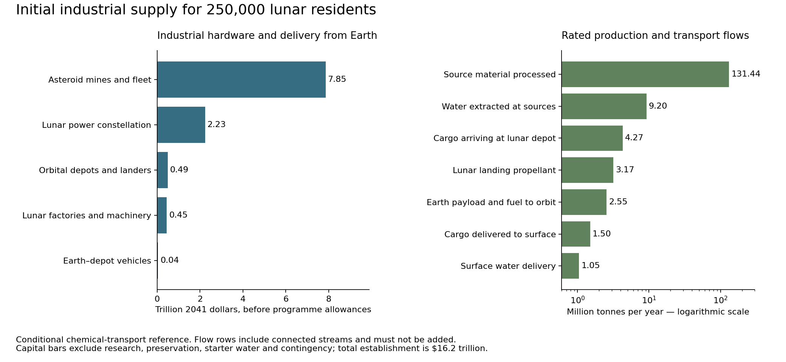

# Industrial supply for the first 250,000 lunar residents

The current [production, co-product and growth study](economy.md) separates domestic output from Earth trade and tests how retained construction capacity can supply renewal, exports and expansion. It replaces the earlier population-based export allowance with physical capacity constraints, accounts for unused asteroid products and derives growth subject to the adopted crater quotas. Product demand, modular manufacturing and source permissions remain conditional.

The original procurement baseline follows below. The first four cities and 100 crater towns require a large transport and production system even when machines perform most routine work. Under the reference chemical-transport scenario, which launches Earth–depot transfer propellant from Earth, establishing that system takes **$16.2 trillion in 2041 dollars**. Funding its initial material deliveries, operation, replacement provision and the settlements’ material replenishment during construction brings the industrial campaign to **$51.4 trillion**. Continuing supply after occupation requires **$1.41 trillion per year**, while retaining the construction fleet and factories for subsequent growth. These are conditional engineering allowances, with technology, sources, routes and prices still to qualify.

The calculation retains the [250,000-person settlement design](../lava_tube_cities/buildout.md): four cities of 50,000 and 100 towns of 500. It treats autonomous industrial operations as available in **2041**, followed by deployment and production. Prices rise by 3% annually from 2026 through 2041, giving **1.557967 dollars in 2041 for each dollar of 2026 purchasing power**, and remain flat thereafter. Automation readiness is the scenario premise; it does not establish that asteroid mines, reusable cryogenic fleets or gigawatt power beams will also be qualified by that date.

The [freight architecture comparison](transport.md) now separates Earth-launched propellant from manufactured cargo and compares depot refuelling and electric transport. The figures on this page preserve the original scenario for reproduction; its launch count is not a demonstrated system requirement or an optimized transport solution.

The [earlier revenue and resource study](revenue.md) remains a prescribed external-cash stress test. Its $56.65-billion/year portfolio does not measure the domestic economy or maximum exports. The current synthesis and revised comparisons are in [economy.md](economy.md); the original industrial and transport products remain reproducible baselines.

## What the estimate pays for

| Case | Industrial establishment, trillion USD2041 | Industrial and material campaign, trillion USD2041 | Annual sustaining supply, trillion USD2041 |
|---|---:|---:|---:|
| Favourable engineering and procurement | 2.44 | 8.83 | 0.243 |
| Reference chemical transport | 16.21 | 51.39 | 1.412 |
| Local fleet fabrication comparison | 10.79 | 37.41 | 1.023 |
| Adverse engineering and procurement | 259.84 | 704.66 | 19.171 |

Industrial establishment includes machinery, spacecraft, power sources, hardware delivery from Earth, starter propellant, development and preservation allowances. The campaign column includes that establishment, the settlement’s initial imported material stocks and freight, **22 equivalent years of supplier operation and funded renewal**, and **13.25 fully occupied equivalent years of settlement import replenishment**. It is a funding envelope with annualized replacement reserves; actual replacement purchases would follow commissioning dates and component condition. Its annual supply figure includes replacement of industrial equipment and the settlement’s imported replacement components, air and water. No discounting or financing is applied.

The favourable and adverse cases change engineering as well as price. They are scenario comparisons, rather than confidence limits. The adverse case would require redesign before a construction commitment. The local-fabrication comparison retains reference prices and makes part of the cargo fleet at the source, with the additional plant described below.

Settlement buildings, farms, life-support equipment and ordinary goods already have a [578.2-billion-U construction account and 22.19-billion-U annual account](../lava_tube_cities/buildout.md). Their material procurement overlaps this supplier account. **Those U totals must not be added to these dollar totals.** This study replaces assumed supplier availability with a costed supply system. A complete settlement dollar budget still requires matching and repricing the retained civil installation, food-growing, municipal and household services. Passenger transport, financing and planetary terraforming are outside this industrial-material account.

## The inherited material requirement

| Initial settlement stock or activity | Quantity | Supply route |
|---|---:|---|
| Finished glass, ceramic, aggregate and other bulk products | 47.90 million tonnes | Lunar feed, forming and installation |
| Finished metal | 6.86 million tonnes | Lunar refining, alloying and fabrication |
| Loose shielding | 24.75 million tonnes | Local excavation and placement |
| Total handling, including feed and grading | 173.81 million tonnes | Lunar earthmoving; this includes the preceding material streams |
| Pressure reinforcement and barriers | 1.84 million tonnes | Qualified Earth manufacture initially |
| Other specialist imports | 2.40 million tonnes | Earth equipment, controls, biological and chemical stocks |
| Initial air and water | 4.96 million tonnes | Qualified ordinary small-body resources |

The specialist-import total contains **150,000 tonnes of construction machinery** already allowed in the preceding study. This calculation removes that mass from the settlement procurement list and includes it once in the industrial fleet. It also retains the existing ground power, storage and radiator inventory, adding capacity only beyond the previous **2 GW construction allocation**. The orbital generators themselves were not engineered in the earlier account and are added here.

At full occupation, the existing water account needs **846,554 tonnes per year**; air replacement adds **8,240 tonnes per year**. Imported components, biological material, nutrients and other specialist supplies account for the rest of the earlier **1.01-million-tonne annual import flow**. The additional supplier calculation replaces roads over 40 years, other bulk assets over 80, and metals over 50, with 95% end-to-end mass recovery. These are new physical-throughput assumptions, distinct from the earlier financial asset lives. Full reprocessing is charged even where recycled material reduces virgin feed.

## Mines and factories on the Moon

Lunar production supplies the mass that is inexpensive to obtain close to the towns: shielding, aggregate, cast and sintered glass-ceramics, structural metal, floors, foundations, roads, tanks and ordinary fabricated parts. Robotic excavators and haulers feed enclosed crushing and sorting lines. Separate thermal and electrolytic trains recover metal; casting, rolling, machining, joining and inspection turn it into specified components. Dust, slag and useful by-products remain in controlled inventories. The aggregate 90% bulk-product yield and 10% metal-product yield are inherited assumptions requiring deposit-specific assays and process designs.

The reference system handles **9.08 million tonnes per year**, produces **3.37 million tonnes of bulk products** and **0.506 million tonnes of metal**, and draws **2.61 GW on average**. Installed industrial power is **4.08 GW**, including capacity margin and process availability. Its representative fleet contains 26 excavators, 156 haulers, 61 bulk-processing trains, 91 metal-refining trains and 181 fabrication cells, together with the 150,000-tonne construction and service-machine stock. These are capacity equivalents distributed among regional sites, rather than a final list of individual machines.

The sizing uses a 100-tonne/hour excavator at 50% availability, 50-tonne haulage payloads on three-hour cycles, 10-tonne/hour bulk trains and 1-tonne/hour metal trains. Factory and vehicle counts include 25% spare capacity. Metal processing receives 35 kWh/kg in the reference case, with 20 and 60 kWh/kg comparisons; these allowances cover a future integrated process rather than a measured lunar production line. NASA’s recent molten-regolith experiment processed a 25 kg simulant charge and produced about 0.07 kg of oxygen per hour. Continuous operation, separation into useful alloys, electrode life and product certification remain major scale-up tasks. [NASA reactor presentation](https://ntrs.nasa.gov/api/citations/20260006167/downloads/MRE%20GCD%20ICES26_v3.pdf).

High-performance pressure composites, liners, electronics, advanced bearings, specialty seals and alloying additions remain Earth supplies initially. Autonomous assembly and repair can develop from robotic earthmoving, welding, machining, machine vision and nondestructive inspection. A factory’s ability to fabricate its frames does not establish that it can manufacture every component needed to repair itself. Shops therefore hold interchangeable modules, diagnostic equipment and imported spares, with human oversight included in the operating allowance.

## Ordinary small bodies as the volatile source

The source operation encloses excavated material or detachable blocks, heats them, captures released volatiles, separates nitrogen-bearing gases and water, and stores products for controlled transfer. Hydrated minerals require heating and chemical processing; a dark asteroid is not a surveyed tank of free water. The reference assumes 10% water-equivalent content with 70% recovery and 0.24% nitrogen with 60% recovery. Bennu samples provide a chemical precedent for the nitrogen concentration, but Bennu is not designated for extraction. Its measured composition establishes neither those recovery fractions nor a sufficient accessible inventory. [Glavin and colleagues](https://doi.org/10.1038/s41550-024-02472-9).

The resulting rated requirement is **131 million tonnes of source material per year**, yielding **9.20 million tonnes of water** and **41,200 tonnes of nitrogen**. Water demand sets the feed rate in this case. Roughly **122 million tonnes per year** remain as controlled material at the source. About 1,154 nominal 25-tonne/hour mining and thermal-processing trains supply this capacity, at 65% availability and with the additional capacity margin. Their power system supplies **11.6 GW on average**; its solar arrays are sized at 70% of the sunlight available at Earth’s distance, with end-of-life degradation and capacity margin. Direct solar heat is a possible alternative to part of the electric-heating allowance.

The literature establishes laboratory precedents for enclosed optical extraction, not an operating asteroid mine. The source programme must qualify anchoring, low-gravity material capture, dust control, gas cleanup, volatile retention, heat rejection, autonomous repair and the changing stability and spin of an excavated body. Its **2.63-billion-tonne campaign feed envelope** and **21.2 billion tonnes including 200 years of sustaining feed** are requirements to be surveyed. The latter equals the mass of a sphere about **3.0 km across at 1,500 kg/m³**; it grants no permission to consume such a body and assumes no allowable extractable fraction. [NASA optical-mining programme](https://www.nasa.gov/general/optical-mining-of-asteroids-moons-and-planets-to-enable-sustainable-human-exploration-and-space-industrialization/).

## Transport and its propellant supply

The reference route uses reusable hydrogen–oxygen cargo vehicles between selected near-Earth sources and a lunar orbital depot, and separate vehicles between the depot, Earth orbit and the lunar surface. Near-Earth resources here mean suitable small bodies reached through measured flight opportunities. The assumed velocity changes are **2.5 km/s each way for the source route**, **3.8 km/s each way between low Earth orbit and the depot**, and **2.8 km/s each way between the depot and the surface**. They are design allowances; no actual asteroid ephemeris has been selected to satisfy them.

For each round trip, the rocket equation counts the outbound payload, vehicle dry mass and all return fuel. Source vehicles also carry replacement machinery back from the depot. The model iterates hardware, replacement, propellant, extraction and power requirements until those flows agree. A 10,000-tonne source cargo vehicle has 1,000 tonnes of dry mass and a three-year round trip in the reference case. A surface lander carries 100 tonnes, weighs 40 tonnes dry and attempts 30 cycles per year; fleet availability is 80%. The resulting fleets contain approximately **2,003 source cargo vehicles, 782 lunar landers and 824 Earth-orbit transfer vehicles**.

To deliver **1.50 million tonnes per year to the surface**, the landers need **3.17 million tonnes of propellant**. The source vehicles deliver **4.27 million tonnes per year to the depot**, including water for that propellant, and consume another **4.97 million tonnes** on their own routes. Electrolysis and liquefaction are therefore production industries in their own right. The reference allows **65 kWh/kg of hydrogen**, compared with DOE’s 55 kWh/kg system status for terrestrial electrolysis and 46 kWh/kg ultimate target, before cryogenic space integration. [DOE electrolysis targets](https://www.energy.gov/cmei/fuels/technical-targets-proton-exchange-membrane-electrolysis).

A nominal oxygen-to-hydrogen mass ratio of eight uses all the extracted water. Diverting a small amount of oxygen into breathable-gas inventory makes the lander mixture slightly hydrogen-rich, while keeping every kilogram assigned. The reference **430-second specific impulse** and long reusable life at this mixture require qualification, especially chamber cooling. Prior hydrogen–oxygen tests included mixtures from 5.8 to 8.4 and an adjusted 430-second vacuum result for a particular nozzle; they do not demonstrate this complete engine requirement. Earth departure, landing, braking, return propulsion and a 3% propellant margin are all present. [NASA combustor record](https://ntrs.nasa.gov/citations/19950009913).

Cryogenic tanks require insulation, active cooling, leak detection and redundant controls through multi-year storage. Orbital workshops service propulsion modules and tank sections; industrial gas inventories and propellant storage carry a quarter-year buffer. Landing pads, blast protection, dust isolation and approach corridors belong outside inhabited and protected terrain. Rocket exhaust requires a plume and contamination assessment before those routes can be cleared. The surface fleet alone has roughly **0.9 GW of average exhaust kinetic power** during rated production; its location and interception matter more than a global average.

## Power before the full planetary array exists

The ground requires **13.67 GW of installed firm capacity**, combining the retained settlement system with the additional industrial load. A costed first constellation supplies that demand independently of the future full-Moon array. The geometry screen uses ten equally spaced equatorial stations, 10,000 km above the surface, each able to supply half the aggregate ground demand. At receiver latitudes within 45°, at least four stations lie above the geometric horizon; one station failure and one lunar eclipse leave two. This deliberately redundant design requires **157 GW of solar nameplate capacity**, about **361 km² of solar collectors**, after radio-frequency conversion, beam capture, receiver and degradation allowances.

This is an ideal visibility bound. Long-term orbital stability, stationkeeping, solar-pressure loads, beam scheduling, terrain horizons and common failures need simulation. Earth eclipses are handled separately by curtailing industry and using the settlement reserve: its usable energy supports approximately **10 hours of the full occupied mean load**, against a six-hour common-eclipse screen. The original 72-hour critical-load reserve remains the underlying inventory. Seasonal eclipse geometry and recovery of reserve charge must be resolved before the supply is certified as firm.

At 2.45 GHz, a 1.2 km transmitting aperture has a first-null diffraction radius of about **1.68 km** at the conservative far range used here. Receiver areas total approximately **68 km²** at an assumed mean delivered flux of 200 W/m². Beam shaping, sidelobes, aircraft exclusion, precision pointing and independent shutdown remain engineered functions. The ten stations need about **35 km² of converter radiator surface** within their hardware allowance. Source processing and depot propellant production add approximately **15 and 1.7 km² of emitting radiator area**, respectively, at 350 K. The complete space-power assembly allowance is 100 W of solar nameplate capacity per kilogram, including the beam converters and their radiator mass. Solar cells reject their own conversion heat separately.

Gigawatt beaming and these deployed structures are development commitments. NASA’s 2024 assessment studied conceptual 2050 systems and identified major feasibility and cost gaps. Solar cells, radio-frequency conversion and radiators provide physical starting points; automation supplies neither a tested antenna nor a qualified continuously available power system. [NASA space-power assessment](https://ntrs.nasa.gov/api/citations/20230018600/downloads/OTPS%20SBSP%20Report%20Final_Tagged_Approved_1_5_24.pdf).

## Fabricating the transport fleet in space

The local-fabrication comparison makes 70% of cargo-vehicle structural mass at the source after a 5% Earth-built seed, equivalent to **66.5% across the initial fleet**. Earth continues to supply propulsion hardware, controls, specialty joints, seals and alloyants. The dry-to-payload ratio rises from 0.10 to 0.12 to allow heavier locally fabricated structures. Refineries and fabrication cells process **about 160,000 tonnes of metal per year**, including renewal, using an assumed 8% aggregate metal grade, 60% recovery and 45 kWh/kg for refining and fabrication. Their additional machinery, electricity, radiators and replacement imports are included.

This reduces industrial establishment to **$10.8 trillion**, the campaign to **$37.4 trillion**, and annual sustaining supply to **$1.02 trillion**, at reference procurement prices. It is a useful development direction because it removes repeated Earth launches of large structural components. It depends on measured metal grades, suitable alloys, cryogenic fracture resistance, leak-tight welding, inspection and repair. The reference Earth-built fleet remains the comparison until those capabilities are demonstrated; no site or manufacturing architecture is adopted by this study.

Water-electric propulsion is a second development option. The single-vehicle comparison assumes 2,000 seconds of specific impulse, 4 km/s per leg to allow a less impulsive route, and one year of powered flight within a multi-year journey, with solar-array performance referenced to Earth’s distance from the Sun. At 30–50% overall efficiency, carrying 10,000 tonnes requires **38–70 MW of propulsion electricity**, **1,394–1,974 tonnes of dry vehicle**, and **3,140–3,432 tonnes of water propellant** per round trip. Arrays, radiator mass and power-processing equipment are included in the dry-mass iteration. Laboratory water-derived Hall propulsion supports investigation, while these efficiencies, power levels and lifetimes remain prospective. No fleet-wide saving is assigned before trajectory, engine life and replacement costs are designed. [Water-electrolysis Hall experiment](https://doi.org/10.1016/j.actaastro.2024.03.043).

## Earth procurement and environmental demands

The reference launch allowance is **$200 per kilogram to low Earth orbit in 2026 purchasing power**, or **$312/kg in 2041**. The favourable and adverse cases use $50 and $1,000/kg before inflation. These are future bulk-service assumptions expressed in 2026 purchasing power and inflated once. For context, SpaceX’s current smallsat rideshare page lists $350,000 for 50 kg to sun-synchronous orbit and $7,000/kg for additional mass; that service is not a comparable bulk cargo contract. No advertised future vehicle capacity establishes the price or cadence required here. [SpaceX rideshare terms](https://new.spacex.com/rideshare).

The hardware allowances also require industrial development: **$500/kg for lunar machinery**, **$1,000/kg for source mining hardware**, **$1,500/kg for spacecraft**, and **$3/W for complete space solar-power hardware**, all in 2026 purchasing power before delivery. Pressure components receive $60/kg and the remaining specialist goods a weighted $150/kg manufacturing allowance. These are transparent scenario inputs rather than supplier quotations. The near-term terrestrial basis includes large autonomous electric mining fleets: Fortescue’s September 2024 agreement covered 475 machines and technology for US$2.8 billion, a package whose scope cannot be reduced to a lunar truck unit price. [Fortescue equipment agreement](https://www.fortescue.com/en/articles/fortescue-signs-us-28-billion-green-equipment-partnership-with-liebherr).

In this Earth-propellant architecture, the rated Earth launch flow reaches **2.55 million tonnes per year**. Earth–depot propellant contributes **1.710 million tonnes, or 66.9%**; manufactured cargo and industrial hardware contribute **0.845 million tonnes**. At 100 tonnes per launch, that is approximately **25,550 launches annually**, or 70 per day across the supply network. A 200-launch/year pad assumption implies **128 operating pads**. Launch service purchases include the provider’s vehicles, pads and fuel; their capital is not added again to the owner’s space-industrial budget. This is a conditional cadence for the original architecture. The [transport comparison](transport.md) recalculates alternatives with less Earth-launched mass and their supporting equipment, source throughput and costs; it establishes no minimum launch requirement.

A separate Earth resource screen allows 50 kg of methalox propellant per kilogram reaching orbit. It implies **128 million tonnes of launch propellant annually**, including **27.8 million tonnes of methane**. Combustion generates about **76 million tonnes of CO₂ per year** before any synthetic-fuel carbon recovery. Producing the methane synthetically at 30 kWh/kg would require about **95 GW of continuous electricity**. Carbon sourcing, non-CO₂ atmospheric effects, launch-site habitats, noise, flight corridors and consent remain part of the project’s Earth-impact assessment. The launch-service price must cover those obligations; the arithmetic gives no environmental clearance.

## Capital, schedule and the conversion of U

| Reference industrial establishment component | Trillion USD2041 before contingency |
|---|---:|
| Lunar mining, processing, fabrication and incremental ground utilities | 0.449 |
| Asteroid mines, process power, refineries and cargo fleet | 7.851 |
| Lunar landers, orbital depots and propellant plants | 0.492 |
| Earth-orbit transfer fleet | 0.044 |
| Dedicated lunar beaming constellation | 2.230 |
| Scientific preservation and environmental allowance | 0.553 |
| Research and qualification | 0.156 |
| Earth-supplied starter water and delivery | 0.233 |
| Direct establishment | 12.009 |
| Establishment including 35% contingency | 16.211 |

The source fleet is the largest capital item. The reference funds 15,000 industrial and oversight staff at an assumed loaded $200,000 per year in 2026 purchasing power. These roles are shared between remote Earth staff and lunar workers within the existing population. Supplier upkeep receives 2.5% of installed capital annually, with component renewal over 10–25 years. The annualized allowances cover maintenance services and consumables within the equipment replacement envelope; a detailed bill of electrodes, catalysts, lubricants and seals remains to be developed. Major imported hardware replacement and its freight are explicit mass flows.

Starting in 2041, an eight-year survey, qualification and bootstrap interval establishes the first source capacity around **2049**. Five years of linear production ramp reach full rate around **2054**. Twenty equivalent production years plus the ramp penalty and two years of final commissioning place completion around **2074**. This is a capacity schedule conditional on parallel city-site qualification, suitable sources and functioning machinery. It is not a critical-path construction plan or a promise of occupation dates. Early regional towns can open while later production continues; the exact settlement sequence is still to schedule.

Reducing launch cost alone to $50/kg lowers the reference campaign to **$32.9 trillion**. Reducing annual water makeup to one quarter lowers it to **$37.0 trillion**, while preserving the original initial water inventory. That water case requires a redesigned and demonstrated recovery system; the extra recovery equipment and electricity have not yet been charged. Compressing stock delivery to ten equivalent years moves the arithmetic completion to about **2064**, but raises initial industrial capital to **$21.0 trillion** and has not demonstrated faster habitat installation. Extending delivery to forty years lowers initial capital to **$13.9 trillion** while increasing the campaign to **$67.9 trillion** because the operating system must be sustained longer.

A matched procurement basket gives an initial, scoped calibration of **1 U ≈ $68 in 2041**, or about **$43 in 2026 purchasing power**, for the reference design. It compares the inherited pressure-system, volatile-delivery and additional-freight prices of 60, 1 and 10 U/kg with their level annual cost allocations here. The favourable case gives about $13/U. Component comparisons differ substantially: approximately $25/U for pressure systems, $670/U for volatiles and $143/U for freight. The older relative prices therefore do not describe this early chemical-transport economy consistently. The $68/U figure can label this procurement basket; a universal currency conversion requires repricing the rest of the economy and specifying the basket U is intended to preserve.

## Conservation and the eventual Open Moon

Extraction follows scientific and heritage review, sampling and future-resource reservation. The [conservation programme](../conservation/README.md) requires ordinary sources and protects unique bodies, polar records and heritage settings; its adopted gas-supply direction allows lunar oxygen as a by-product of local metal and glass production. This estimate assigns no lunar oxygen-mining campaign, polar water mine, protected-body source, or independent mineral-export revenue. Lunar phosphorus, potassium, other nutrients and scarce alloying elements require assays, recovery and retained accessible stocks before a deposit can be released for use.

Lunar factories, roads, power receivers and access works must be checked against future dry terrain, groundwater and park allocations. Their long-lived structures should accommodate later weather protection, corrosion control, drainage and relocation; the eventual inhabited places retain their domeless design goal. High-temperature processing, propulsion depots and other suitable activities can move toward orbital platforms as the atmosphere grows. The initial lunar orbits, vacuum landing system and exposed machines would then need replacement or alteration. Those future planetary transition works remain outside this first industrial campaign.

A 5% preservation and environmental capital allowance and explicit lunar restoration spending are budget entries, not demonstrations of sufficient protection. Source reserves, nutrient retention, launch impacts, exhaust transport and safe controlled delivery remain release conditions. No mass-driver catcher, free orbital braking, fusion economy or complete machine self-reproduction is assumed to resolve them.

## Reproduction and next engineering work

[The calculation](run.py), [inputs](industrial_inputs.json), [results](results/industrial_system.json) and [source register](industrial_sources.json) keep the engineering and price assumptions inspectable. Run `python -m research.studies.initial_industrial_system.run --output research/studies/initial_industrial_system/results/industrial_system.json` and `python -m pytest -q research/studies/initial_industrial_system/test_run.py`. [Verification](checks.md) records numerical, structural, provenance, editorial and visual checks separately.

The next useful work is a qualified source-and-route campaign, coupled to a water-recovery design and a cargo-fleet manufacturing study. Measured volatile and metal yields, demonstrated refurbishment intervals, power-system coverage and operating launch contracts would replace the largest assumptions. Those results should precede a unified settlement-dollar budget, whose supplier credits and retained living-service costs can then be reconciled without counting the same production twice.
