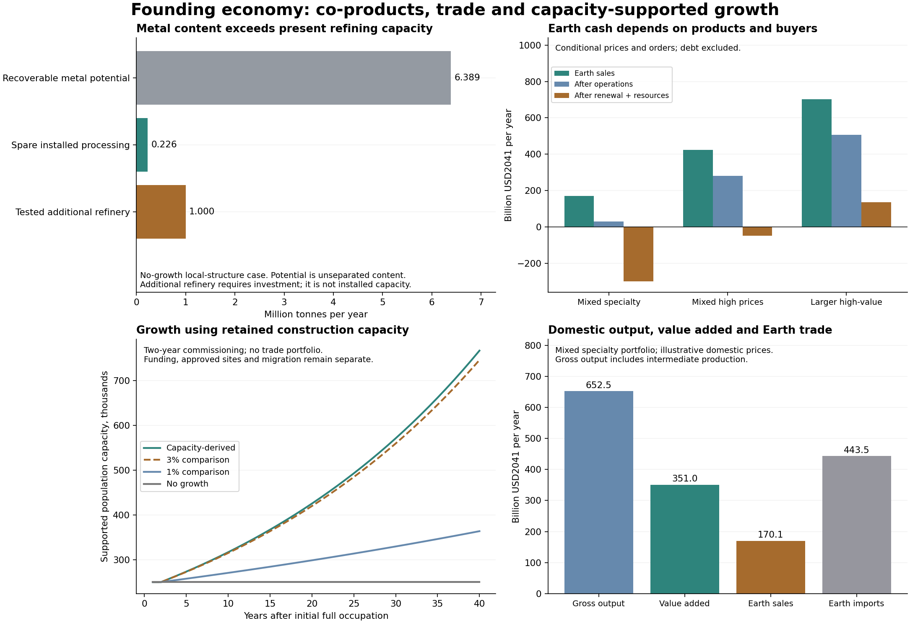

# Production, co-products and growth of the founding lunar economy

The first four cities, 100 crater towns and their supporting industry form a **250,000-person economy with substantial production beyond its sales to Earth**. This revision accounts for that domestic production, tests commercial use of retained construction capacity, and follows the materials and investment required for expansion. It also treats asteroid feed as a source of several products: useful material retained after water extraction can supply later construction, nutrients and specialist production, provided the corresponding processes are qualified.

The earlier [revenue calculation](revenue.md) remains reproducible as a prescribed external-cash stress test. Its $56.65 billion of annual receipts measured one portfolio of Earth sales. Its population-based factory allowance and customer-budget ceilings did not establish the productive economy's size or its maximum trade. The new calculation replaces those limits with competing material, power, fabrication and transport demands. **Future product prices and orders remain scenarios.** A profitable capacity case is a requirement for a business to qualify, rather than evidence that its customers already exist.

All principal financial tables use **billions of 2041 USD per year**. Prices retain 3% inflation for fifteen years, a factor of 1.557967 from 2026 purchasing power, and flat prices afterward. The figures describe a year after full occupation; 2041 remains the assumed availability of high automation, rather than the date all settlements operate. The original chemical deployment schedule reaches occupation around 2074. No new deployment date is adopted here.

## The boundary and the three accounts

The domestic account covers food and aquaculture, ordinary goods, housing and public services, construction, replacement equipment, mines, processing, power and transport throughout the off-Earth system. **Gross output** includes intermediate production. **Gross value added, or GDP**, deducts domestic and imported intermediate inputs; imported completed equipment enters investment and imports once. Consumption of fixed capital is deducted once to obtain net domestic product. These follow the [BEA definitions of gross output and value added](https://www.bea.gov/help/faq/1197).

The external account records final purchases by Earth residents or institutions and purchases from Earth. Payments between the Moon, its sources and other off-Earth industries are internal transfers. An Earth-financed orbital factory is domestic investment financed from outside; selling its frames to another off-Earth operator does not create a second Earth export. Direct Earth mission procurement counts only as final external demand, with no additional credit for the same mission's internal fuel purchases. Borrowing, equity and grants are financing. Construction debt, taxation and dividend policy remain separate.

The growth account adds buildings and productive equipment together. New equipment consumes existing capacity during manufacture and enters service after a two-year commissioning delay. Its later maintenance and imports then rise with the installed stock. The calculation uses the founding settlement's quantities per supported resident as a material-intensity proxy; it does not repeat the initial four-city/100-town distribution as a siting plan.

## What the asteroid operation produces and retains

The following balance is for **local structural fabrication, no new commercial facilities and no growth**, retaining the initial construction system. It uses the original water, nitrogen and aggregate-metal grades and recoveries. Those are source-design assumptions, requiring assays of permitted bodies. They do not designate Bennu or another scientifically important object for extraction.

| Annual stream | Model quantity | Meaning |
|---|---:|---|
| Joint source feed | 133.27 million tonnes | Material entering the controlled extraction process |
| Recovered water required | 9.329 million tonnes | Includes propellant production throughout the network |
| Nitrogen required for air | 6,345 tonnes | Food nutrient nitrogen remains in the separate nutrient account |
| Virgin source metal required | 8,034 tonnes | Supplement to recycled structural material |
| Total source metal processing | 163,956 tonnes | Includes recovered frames and fabrication; it exceeds virgin extraction |
| Controlled residual material | 123.92 million tonnes | Solids and captured, unallocated constituents; containment is a process requirement |
| Additional metal recoverable under the grade/recovery assumptions | 6.389 million tonnes | Potential content, before the limiting refinery and product qualification |
| Additional recoverable nitrogen-equivalent content | 185,561 tonnes | Requires separation, purification, capture and a use |
| Spare existing metal-processing capacity | 226,186 tonnes | Before competing growth, other exports and containment material |

Water, nitrogen and metals share the same feed. The calculation charges extraction once and uses the largest feed requirement among those products. Water split into oxygen and hydrogen remains the same mass; it does not become a second mineral credit. Nickel, cobalt and platinum-group metals belong within the aggregate metal inventory. Their individual quantities cannot be added to that inventory as further tonnes.

The useful distinctions are **material already used**, **finished stock held for later use**, **products delivered to Earth**, and **unseparated potential remaining under control**. Used structural metal already reduces replacement imports in the fabrication comparison. Additional finished stock enters domestic inventory investment at an explicit valuation. Its creation consumes power, alloy additions, plant time and containment materials. Material left in the extraction residue retains possible future value; the study leaves that value unpriced until assays and processing designs support it.

### More refinery capacity and the value of its output

Almost 6.4 million tonnes of additional recoverable metal content is much larger than the roughly 226,000 tonnes/year of spare refining capacity. An extra **one-million-tonne/year** source refinery would require about **107,653 tonnes of machinery**, divided into **75,357 tonnes of locally fabricated structures** and **32,296 tonnes of imported functional equipment** in the modular comparison. Processing adds about **5.13 GW**. Existing source generation and heat rejection can accommodate that particular addition in the tested maintenance case; these same reserves are also available to computing and growth.

Staging that plant over five years alongside its full eventual output requires **$78.34 billion of additional Earth purchases**, **$3.52 billion of locally valued components**, **$5.38 billion of installation allowance**, and **$1.26 billion of resource provision**. These are direct scenario allowances before an additional procurement contingency. They include a five-year, $10-billion-in-2026-purchasing-power qualification programme, with its test hardware and freight. Passing the capacity screen does not establish that the qualification programme succeeds.

Producing one million tonnes of additional finished metal stock each year increases external operating and renewal purchases plus resource provision by about **$15.68 billion/year**. The product has an illustrative inventory value of **$4.67–46.74 billion** at $3–30/kg in 2026 purchasing power; the $10/kg comparison gives **$15.58 billion**. These are valuation cases for specified products, with higher values requiring more useful fabrication and qualification. They are not cash receipts or profit. The model adds two kilograms of containment structure per tonne of stock. Continued production requires an actual construction use or a funded inventory plan, rather than indefinite accumulation.

Using 99% of the current spare metal capacity, before the containment allowance, produces about **223,924 tonnes** of additional stock. At $10/kg its inventory value is **$3.49 billion**, with about **$2.59 billion** in incremental Earth purchases and resource provision. This shows why co-products deserve an economic account while keeping their internal value separate from Earth cash.

### Carbon, nutrients and trace metals

The existing food system requires about **87 tonnes of nitrogen, 12.3 tonnes of phosphorus, 18.8 tonnes of potassium and 50 tonnes of mixed trace nutrients annually**. Food and everyday manufacturing together require **5,000 tonnes of replacement carbon**. At a trial 50% recovery, meeting those carbon needs from the joint feed would require only **75 parts per million of carbon**; phosphorus would require about **0.185 parts per million**. These are threshold calculations, rather than assays or certified feed recipes.

Bennu provides a relevant compositional analogue. [Keller and colleagues' preliminary sample report](https://ntrs.nasa.gov/api/citations/20240006219/downloads/Keller%20TEM%20of%20carbonaceous%20matter%20in%20Bennu%206385.pdf?attachment=true) describes approximately 4.7% carbon by mass. Applied as an analogue to this feed, that is 6.26 million tonnes of contained carbon, or 3.13 million tonnes at the trial recovery. [NASA's phosphate report](https://www.nasa.gov/solar-system/surprising-phosphate-finding-in-nasas-osiris-rex-asteroid-sample/) also identifies phosphate and sulfide minerals. Neither observation qualifies a source, a recovery process or food-grade purity. The [54-element aggregate analysis](https://ntrs.nasa.gov/api/citations/20240000341/downloads/Koefoed_LPSC%202024%20Bennu%20Elemental%20Comp.pdf) supports investigating a broad product slate, with individual concentrations still needed for the industrial design.

Replacing all currently imported food-nutrient/carbon compounds and everyday carbon feed would displace at most **12,179 tonnes of Earth cargo per year**, worth a gross **$6.64 billion/year** at the inherited procurement and launch prices. Refining, feed synthesis, contaminants, packaging, source-to-Moon delivery and certification must be paid before this becomes a net saving. No such saving has been booked into the reference trade results. Sulfur, phosphorus, potassium, specific alloying elements and trace-metal products remain identified processing opportunities, with absent grades and recoveries stated explicitly.

Precious metals also require a market response calculation. As a sensitivity, **one part per million of platinum in the joint feed**, recovered at 50%, would yield **66.6 tonnes/year**. That equals about 39% of the USGS estimate of 2025 world mine production. At the frozen 2025 price it represents roughly **$2.57 billion in 2025 dollars before processing and delivery**, with a substantial possible price effect. No platinum grade is assigned to an asteroid, and no revenue from this trial is credited. The 0.01 and 0.1 ppm cases remain in the product. [USGS, Mineral Commodity Summaries 2026, platinum-group metals](https://pubs.usgs.gov/periodicals/mcs2026/mcs2026-platinum-group.pdf).

## Equipment renewal and local manufacturing

The engineering comparison preserves the original pressure, tank, trajectory, payload, availability and spare-capacity assumptions while changing the parts that must be renewed. Its three profiles are:

| Profile | Structural maintenance and procurement |
|---|---|
| Inherited | Earlier component lives and Earth procurement, with the existing locally made tug structure fraction |
| Modular, imported | Longer-lived structures separated from active modules; structures otherwise continue to be imported |
| Local structures | The same modular lives, with eligible structures fabricated at their use region or at the source and transported to orbital use |

The proposed structural fractions are 70% for machines and solar equipment, 80% for vehicles, 65% for landers, 90% for radiators, 50% for chemical equipment and 85% for tanks. Proposed structural lives range from 30 to 50 years, retaining a longer inherited life where applicable. **Active modules retain their earlier replacement lives. Pressure barriers, reinforcement and computer/communications equipment remain imported.** Producing a frame is not equivalent to producing its electronics, seals, sensors or propulsion system.

Local structures retain the earlier mass and performance. Alloy compatibility, fatigue, joining, inspection and manufacturing tolerances must support that assumption; an overweight replacement could change the fleet and its propellant requirements. The calculation includes 2% imported alloy additions to new local metal, 95% structural recovery, finishing energy, transport of new orbital frames and return transport of retired metal. Retired imported modules remain a controlled recovery opportunity, without a new recycling credit.

The modular profiles also replace the earlier percentage-of-total-capital Earth maintenance bill with **7,500 Earth staff equivalents, a $2 billion/year external engineering allowance in 2026 purchasing power, and process supplies equal to 5% of imported industrial replacement mass**. This is a proposed maintenance budget, separate from the material-localization effect. A stress case restores the larger inherited service bill. Imported active-module prices are tested at one, two and four times their inherited price per kilogram, because lighter imported assemblies may retain much of an asset's value.

The following comparison retains the same modest research, media, remote-work and destination-service facilities, with no manufactured exports, extra computing or growth:

| Profile | Operating imports, billion USD2041/year | Renewal imports and associated supply, billion USD2041/year | Source feed, thousand tonnes/year | Nominal 100-tonne Earth launches/year |
|---|---:|---:|---:|---:|
| inherited | 89.00 | 602.80 | 184,995 | 4,800 |
| modular imported | 23.90 | 425.10 | 160,202 | 3,617 |
| local structures | 21.38 | 271.15 | 133,503 | 2,290 |

The launch counts follow a 100-tonne delivered payload assumption and do not establish launch-site capacity or environmental acceptability. The reduction from earlier figures comes from explicit procurement and fuel changes. Electric freight, better recovery and more extensive localization could change it again.

These designs extrapolate from early development. [ESA's 2024 experiment](https://www.esa.int/media/first-metal-part-3d-printed-in-space) produced a metal shape in microgravity for subsequent quality analysis. [Blue Origin's September 2025 announcement](https://www.blueorigin.com/news/blue-alchemist-hits-major-milestone-toward-permanent-sustainable-lunar-infrastructure) reports a design review and a planned simulated-environment demonstration for lunar material processing. Those precedents support investigating fabrication; they do not establish the model's scale, asset lives or readiness date. The phased programme should qualify ordinary structures first, then repairable modules and more demanding alloys, while keeping pressure materials, advanced electronics and other unqualified processes supplied externally.

## Exports, return transport and competing uses

With local structural fabrication and the modest service facilities operating, separate physical limits are approximately **239,000 tonnes/year of lunar finished goods**, **195,000 tonnes/year of asteroid-source finished goods returned to Earth**, or **13.24 GW of source-site batch computing**. The last uses spare source power and radiators, with imported IT and communications hardware. These maxima describe different uses of the same equipment and cannot be added.

Lunar goods travel to the depot, Earth orbit and an entry capsule; source goods bypass the lunar surface. Loaded returns consume propellant. The calculation includes cargo capsules, single-use shields, capsule losses and renewal, Earth recovery services and relaunch of durable buses. The cargo capsule's assumed loss rate is confined to cargo. Visitor destination services require separately qualified passenger access, paid outside the destination-service price; the study does not certify passenger journeys in cargo vehicles.

The mixed portfolio combines 100,000 tonnes/year of lunar products, 50,000 tonnes/year of source products, 1 GW of computing, 25,000 tonnes of final Earth-mission propellant demand and the retained service activities. In its specialty-price case, lunar and source goods receive $750/kg and $30/kg respectively in 2026 purchasing power. The higher-price comparison uses $2,000/kg and $750/kg, with a 50% premium over the computing comparator. Both fit the same physical capacities. The larger manufacturing case instead uses 200,000 tonnes of lunar goods, 3 GW of computing and the same smaller services and mission-fuel demand. It has no separate source-goods export stream.

| Annual scenario | Earth sales | Operating cash surplus | After renewal and resource provision | Expansion purchases from Earth | After expansion and resource provision |
|---|---:|---:|---:|---:|---:|
| Mixed specialty portfolio | 170.10 | 29.65 | -299.34 | 0.00 | -299.34 |
| Same facilities, higher product prices | 424.09 | 281.51 | -47.47 | 0.00 | -47.47 |
| Larger tested manufacturing portfolio | 701.63 | 507.17 | 136.56 | 0.00 | 136.56 |
| Larger portfolio plus capacity-supported growth | 701.63 | 507.17 | 133.57 | 64.19 | 69.38 |

The larger case delivers **194,040 tonnes/year of saleable products** after quality and entry losses. Covering the whole system's operating purchases, renewal and resource provision at that portfolio requires an average delivered product price of about **$2,412/kg in 2041 dollars**, equivalent to $1,548/kg in 2026 purchasing power. The tested higher price is about $3,116/kg in 2041 dollars. These quantities and prices must be supported together. The grid's best result is the best tested combination, rather than a global optimum or a demand forecast.

Existing [manufacturing work](../world_economy/manufacturing.md) identifies candidate filled-resin and glass castings, optical blanks and liquid-phase-sintered parts. Product-specific gravity effects, recipes, certification and competition from Earth or orbital centrifuges remain unresolved. The large scenario's goods sales alone are about $388 billion in 2026 purchasing power. For historical scale, worldwide semiconductor sales were $630.5 billion in 2024; those are different products and dates, and the comparison supplies context rather than a customer ceiling. [SIA/WSTS 2024 sales revision](https://www.semiconductors.org/global-semiconductor-sales-increase-19-1-in-2024-double-digit-growth-projected-in-2025/).

Computing is compared with an Earth installation using the same $47/W of IT and communications, five-year replacement, 60% billable duty, $0.10/kWh electricity and $1/W-year overhead, all in 2026 purchasing power. Both alternatives carry the common 20% external service allowance. Source computing pays its own equipment delivery and renewal; spare power is limited, and data links, radiation tolerance, job latency and customer acceptance remain qualification requirements. This gives a competitive price test rather than the earlier arbitrary revenue per watt. Research, media, professional work and tourism retain explicit staff and facilities; their prescribed demand is not treated as their maximum possible market.

The larger portfolio requires approximately **60,335 resident technical and commercial positions**, including the existing production operators and resident share of industrial staffing. Public services and the rest of the workforce still require allocation. Its five-year overlapping commercialization programme fits current capacity at about 96% of the firm-power limit, with **$309.29 billion of additional Earth purchases** and **$81.78 billion of civil/installation allowance**, plus locally produced components and resource provision. Continuing base operation and any early trading deficits must also be financed.

## Domestic output and investment

At the mixed specialty prices, the consolidated account gives **$652.54 billion/year of gross domestic output**, **$351.01 billion of gross value added**, and **$34.82 billion of net domestic product**. Earth sales are **$170.10 billion** of that activity. These are illustrative price-based accounts; their purpose is to make the omitted domestic economy explicit and consistent with trade and investment.

The four-sector supply-use table in [the result product](results/economy.json) groups industrial supplies, resident services, domestic replacement/expansion work and external sales. Intermediate imports are consolidated into industrial supplies. The model verifies both the sum of sector value added and the expenditure identity, **GDP = consumption + capital formation + exports − imports**. Imported completed capital is absent from domestic gross output. Finished co-product stocks enter inventory change, separately from fixed investment.

Food remains physical production within the resident sector: the inherited farms provide about **293,355 tonnes of fresh crops, 2,557 tonnes of edible fish and 1,705 tonnes of microbial protein annually**, using 26.75 million square metres of installed crop beds and about 3.63 GW of mean food-system power. Ordinary production retains the existing 125,000-tonne/year goods requirement and its recycling flows. The new account preserves these supplies and includes their utilities, equipment and operators.

Domestic service prices require a convention. The worked account uses $30/U for the retained civic-service valuation, takes half the earlier routine-upkeep and process-service allowances as domestic service value added, and retains the explicit civic and production-operator amounts. It removes the old air, water, power, raw feed, freight, equipment renewal and contingencies from that service valuation before adding the new physical supply account. **It never converts the whole 22.19-billion-U maintenance budget and adds the industrial account on top.** The 25–75% routine-service comparison changes this portfolio's GDP from approximately **$298 billion to $404 billion**, while leaving Earth cash unchanged. The transfer prices for local materials and utilities, and the installation allowances, remain visible assumptions in [economy_inputs.json](economy_inputs.json).

## Growth supported by the retained system

After maintenance, the local-structure design can support initial starts equivalent to **7,699 additional residents/year**, together with proportionate new industrial equipment. That is a **3.08% first-year capacity ratio**, set by source metal fabrication. It describes construction capacity; migration, new sites, financing and public services are additional requirements. Retaining more imported structures raises the calculated physical growth limit to 12,500 supported residents/year, while substantially increasing Earth purchases. This is the tradeoff between local production and imported expansion.

With the larger manufacturing portfolio operating, remaining capacity supports about **2,806 additional residents/year and their associated industry**. Its additional Earth purchases are about **$64.19 billion/year**, and the larger resource provision is included in the final table column. Domestic assembly and services are additional internal production and allocation requirements. Growth purchases do not appear as exports.

The forty-year comparisons below begin after initial occupation, with no external commercial portfolio. They therefore show physical construction opportunity and funding requirements independently of assumed sales. Two years of starts remain in the pipeline at the end.

| Growth comparison | Occupied capacity in year 40, people | Capacity in construction, people | Cumulative source feed, trillion kg | Cumulative purchases from Earth, trillion USD2041 |
|---|---:|---:|---:|---:|
| Capacity-derived | 766,523 | 46,524 | 13.51 | 34.02 |
| 0% comparison | 250,000 | 0 | 5.33 | 11.56 |
| 1% comparison | 363,573 | 7,236 | 7.25 | 16.73 |
| 3% comparison | 745,560 | 44,100 | 13.20 | 33.15 |

The adopted crater denominator remains **8,886,558 craters, 200–1,000 m across**. The eventual 2.5% quota is **222,163 sites** and the initial 0.1% vacuum quota is **8,886 sites**. The catalogue-based representative architectural estimate is about **507.5 million residents across the eventual crater set**, with much larger sites and different stages of settlement. It is not a demographic target or a promise that those roofs can operate in vacuum. The initial vacuum population reference is about 6.27 million; adding only the existing four cities gives the 6.47-million reference used to stop this numerical exercise. The forty-year paths remain below it. The uncompleted lava-tube census supplies no further 2.5% denominator, and no atmospheric transition date is assumed.

A proportional retirement screen retains about **80.9%** of the original plant and reduces annual external purchases to about **$242.64 billion** before a commercial portfolio. It is only a continuous sizing bound: a reduced fleet and the ten-station power constellation require discrete reliability and dispatch designs before equipment can actually be retired. The growth cases instead explicitly use the construction plant that the earlier cash account kept charging for.

## Resource endurance, capital and U

Joint products improve the useful recovery of each tonne. They do not replace discharged propellant or establish permission to excavate a source. Even the no-growth local-structure case processes about **133 million tonnes/year**; a million years at that constant rate would require about **1.33 × 10¹⁷ kg** of feed. Growth raises the requirement: the forty-year capacity-derived path consumes about **13.5 trillion kg**, after the founding campaign.

The earlier inventory snapshot contains 43,050 catalogued near-Earth objects but only 1,246 reported diameters. Its deliberately narrow dark-orbit screen, excluding named science targets, represents about 3.12 trillion kg at the assumed density. Dividing that whole scenario mass by the new no-growth feed gives approximately 23 years, before any protected fraction; this is an inventory diagnostic, not an exhaustion forecast. Composition, accessible fractions, changing trajectories, undiscovered objects and permissions remain unresolved. A million-year plan needs much tighter cycles and propulsion use, surveyed source replenishment or eventual access to more distant resources. The timing of that transition cannot be fixed from the present catalogue. A separate socioeconomic boundary for mid- and outer-system activity remains open.

The preserved space-fuel/local-tug procurement case has **$14.50 trillion of industrial establishment** and a **$41.89 trillion industrial/material campaign**. Those figures retain their original deployment and replacement assumptions. They provide capital context; the new modular annual cases do not silently reprice that campaign or solve its bootstrap sequence. Original settlement construction is still 578.2 billion U, with overlapping procurement. Summing the two would count shared material and equipment twice.

For U, **$30 in 2041 dollars per U remains an illustrative working price convention**. The retained destination-service prices span roughly $15.6–77.9/U, with $31.2/U in the reference case. The earlier pressure-procurement cross-check belongs to its earlier transport architecture and is retained as historical evidence. Revenue and capital requirements reveal whether a chosen design can finance imports; their ratio supplies a yield or payback measure, rather than an exchange rate. No peg is adopted. A stronger conversion estimate needs a matched basket of goods and services priced in both units, followed by a convertibility, reserve and financing policy. Changing the internal unit does not change the external funding requirement.

## Reproduction and outstanding qualification

Run `python -m research.studies.initial_industrial_system.economy --output research/runs/initial_economy.json`. The [inputs](economy_inputs.json), [component and flow model](evolution.py), [accounts](economy.py), [source record](economy_sources.json), [review record](economy_review.md) and [checks](economy_checks.md) retain the assumptions and input identities. The preceding industrial, transport and revenue products are preserved.

The calculations establish a broader economic account and conditional capacity limits. Product assays and recipes, long-lived modular structures, passenger access, independent customer demand, financing, protected source reserves and the founding deployment sequence remain substantive engineering and market work. The next useful commitments are product-specific: qualify the structural and nutrient processes that replace the largest recurring imports, test candidate export products against Earth alternatives, and size additional co-product refineries against funded construction or sales. That work can use the retained industrial capacity while keeping the eventual crater quota and resource protections explicit.
