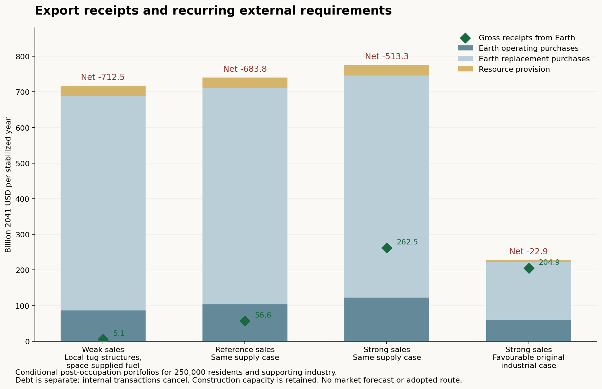

# Revenue, Earth returns and resource endurance of the first settlement system

The 250,000-person settlement and its supporting off-Earth industry can supply valuable goods and services to Earth, but the present estimates do **not yet demonstrate a financially self-sustaining system**. In an illustrative case combining local manufacture of asteroid-tug structures with space-supplied chemical propellant, the reference market portfolio earns **$56.65 billion a year**, spends **$103.01 billion on external operations**, and requires **$607.90 billion for external equipment renewal**. After a further **$29.53 billion resource provision**, the annual funding gap is **$683.79 billion**. These are conditional accounts in **2041 dollars**, with construction capacity retained after occupation. They establish neither future customer demand nor a requirement to retain this costly supply design indefinitely.

A proposed working normalization is **1 U ≈ $30 in 2041 dollars**, checked against the same destination service priced in both units and the earlier pressure-component procurement estimate. The existing relative prices do not support a universal exchange rate. Changing the unit cannot close the funding gap.

The reference source flow also fails to establish million-year local sustainability: it requires **189 million tonnes of asteroid feed each year**. An explicitly assumed usable feed stock of 100 billion tonnes would last about **528 years** at that rate. No such permitted, accessible stock has been established. The catalogue screen and the conditional lifetimes below identify what must be surveyed; they do not approve extraction or predict an exhaustion date.

## Boundary and date

The account consolidates the **four cities of 50,000 residents, 100 towns of 500, and all their modeled off-Earth mines, processors, power systems, transport and commercial facilities**. Purchases between these operations cancel. Food production, aquaculture, ordinary manufacturing, housing and municipal services remain essential production within the system, with their inherited material and replacement demands. Selling these services to the same residents does not create additional income from Earth. Resident pay is an internal distribution; Earth staff, contractors, equipment and supplies are external purchases. The operating result is consequently an **external cash balance**, rather than corporate profit or gross domestic product.

Earth-funded purchases count once, at the boundary. Propellant receipts require independently financed Earth mission customers; fuel consumed by the system's own vehicles or sold between its operators is excluded. Where an off-Earth mission operator belongs inside the consolidated system, its internal fuel purchase cancels and only its final sale to Earth can count. Research and mission purchases share an explicit customer-budget ceiling. Borrowing, equity subscriptions and grants remain financing, outside earned revenue. **Construction-debt service is separate and unspecified.**

The scenario retains 3% annual inflation for fifteen years, multiplying 2026 purchasing-power prices by **1.557967**, followed by flat prices. Autonomous industrial capability is assumed available in 2041; full occupation follows construction. The original chemical schedule reaches the milestone around **2074**. The annual figures here describe a stabilized year after occupation, expressed in 2041 dollars; they are not sales forecast for 2041. Alternative electric routes still need their own integrated commissioning and dispatch schedules.

## Sales that have facilities and external customers

The following reference prices and quantities are **planning assumptions**, not contracted demand, vendor quotations or empirically established lunar premiums. USD unit prices in this table are expressed in 2041 purchasing units; the model stores their 2026-real equivalents and inflates once.

| External activity | Reference annual quantity and price | Gross receipts, billion USD2041/year |
|---|---|---:|
| Manufactured goods delivered to Earth | 15,281 tonnes saleable, about $1,168/kg | 17.85 |
| Visitor destination services | 10,000 visitors, fourteen nights each, about $31,159/night | 4.36 |
| Interruptible orbital batch computing | 200 MW installed information technology, 60% billable duty, about $46.74 per billable watt-year | 5.61 |
| Research contracts | 5,000 dedicated resident staff and additional laboratories | 7.79 |
| Media and licensing | 1,000 dedicated resident staff and equipment | 1.56 |
| Remote professional services | 25,000 resident staff, about $311,593 of external sales each | 7.79 |
| Independent Earth mission propellant | 25,000 tonnes supplied at the lunar depot, about $467/kg | 11.68 |
| **Total** | | **56.65** |

The weak and strong portfolios vary both buyers and prices. Factory utilization ranges from 20% to 90%, the Earth-delivered goods price from $300 to $2,000/kg in 2026 purchasing power, and visitors from 2,000 to 30,000 a year. Independent mission fuel demand ranges from 5,000 to 100,000 tonnes a year. Computing spans 50 MW to 1 GW. The complete assumptions and customer ceilings are in [revenue_inputs.json](revenue_inputs.json). The strong portfolio is an expansive market case, not a likely upper confidence bound. High automation may also lower Earth customers' willingness to pay for these products and services.

For scale, the OECD reports roughly $550–600 billion in worldwide space-related revenue in 2025, much of it from services delivered on Earth using satellites. That figure is a context measure with a different scope; it is neither this settlement's addressable market nor proof that future customers will spend the sums above. The executive-summary text was read through the web tool, while direct archival retrieval returned HTTP 403. That unresolved archive limitation is recorded in [revenue_sources.json](revenue_sources.json). [OECD, *The Space Economy at a Glance 2026*](https://www.oecd.org/en/publications/the-space-economy-at-a-glance-2026_cbf9b240-en/full-report/executive-summary_a0f22eba.html).

The commercial additions have their own equipment and material allowances. The factory has 25,000 tonnes/year of nameplate output, 90% saleable yield, 250,000 m² of floor area, 1,250 tonnes of process equipment and 5 kWh of finishing electricity per kilogram of finished goods. Twenty percent of gross feed is imported from Earth; the remainder and the export packaging use local metal. Rejects are separately accounted for, without assuming costless recycling. Product-specific processes, specifications, assays and customer advantages remain to be demonstrated.

Visitor facilities add **548 beds**, life support, food-growing equipment, water, air and consumables for about **383 guest-years of occupation annually**. Their capacity is additional to resident food provision. Research adds 500,000 m² of laboratories and support space. The orbital computing installation carries its own solar arrays, communications, radiators and five-year computer replacement; its 60% billable duty permits interruption instead of assuming uninterrupted solar power. The reference portfolio allocates about **40,000 resident jobs**, including resident industrial oversight. This is a staffing allowance, not a complete employment or demographic model.

Commercial establishment costs **$59.55 billion**, plus **$0.34 billion of initial resource provision**, in the illustrative supply case. It adds about 430,000 tonnes of local bulk stock, 83,220 tonnes of metal, 1,644 tonnes of water and 3,175 tonnes of air, alongside imported equipment. A five-year placement screen combines these stocks with full steady commercial operations. It fits the retained rated fleet and process capacities, preserving the original separate 25% spare margin and stated availability. Initial source-water extraction and propulsion are included in this screen. Existing plant operation and replacement bills continue throughout those years; the screen is not a construction schedule or a funded transition plan. Civil installation prices and facility bills remain first-order allowances.

## Earth returns: paid propulsion and saleable cargo

The original study priced returning vehicles and their propulsion, but credited no Earth-bound goods. The new calculation explicitly loads goods onto the lunar ascent and depot-to-Earth legs. Space-fuelled Earth transfer vehicles already return carrying propellant for their next outward flight. Additional goods therefore consume tank capacity and propulsion; reducing outward loading or increasing annual trips keeps the constructed vehicles within their limits.

For the reference portfolio, lunar landers average about **97.0 tonnes outward and 1.54 tonnes of packed goods on return**, over approximately **10,714 annual cycles**. The Earth transfer fleet averages **200 tonnes outward and 6.91 tonnes of return goods**, over approximately **2,392 cycles**. Source vehicles continue to return with replacement machinery. The model checks their tanks, available trips, process power and heat rejection against the retained capacity. These annual averages do not replace orbit-by-orbit dispatch planning.

The factory makes 15,750 tonnes of finished goods. Packaging raises the mass returned to low Earth orbit to **16,538 tonnes**. Delivery then uses about **1,654 flights per year** of a proposed 10-tonne payload capsule, with a five-tonne dry mass. Each flight consumes a one-tonne shield; the four-tonne durable bus has a ten-flight retirement limit and a stated 1% loss probability per flight. Deorbit propellant, Earth recovery and onward delivery, replacement buses, and relaunch of both reused and new buses are charged separately. Relaunch mass is counted once. Expected flight and quality losses reduce saleable delivery to **15,281 tonnes**.

NASA's account of Varda's W-5 return establishes a small-scale flight precedent for recovered space-manufactured cargo and NASA-derived C-PICA heat shields. It does not validate these capsule dimensions, costs, reliability, reuse life or flight rate. The proposed fleet still needs thermal protection, controlled entry, recovery, range capacity and environmental qualification. The model pays for propulsive braking to Earth orbit; it grants no free atmospheric capture on that leg. [NASA, *NASA Heat Shield Technology Enables Space Industry Growth*](https://www.nasa.gov/directorates/stmd/nasa-heat-shield-technology-enables-space-industry-growth/).

Manufacturing and computing are included as recurring businesses only when their incremental receipts cover added external operations, replacement and resource provision. The weak portfolio rejects both. Under the original central Earth-fuelled transport case, reference-price manufacturing also fails this test and is excluded, leaving $38.79 billion of gross receipts. That rejection is retained in the result rather than concealing a loss behind gross export sales. Capital recovery and debt could further narrow profitable commercial activities.

## Gross and the two net measures

For the illustrative **local tug structures plus space-supplied chemical fuel** case, all entries below are **billion USD2041 per stabilized year**. No route has been adopted by this comparison.

| Market portfolio | Gross receipts | External operations | Operating cash balance | External renewal | Resource provision | Balance after renewal and provision |
|---|---:|---:|---:|---:|---:|---:|
| Weak | 5.11 | 86.46 | -81.35 | 602.33 | 28.81 | -712.49 |
| Reference | 56.65 | 103.01 | -46.36 | 607.90 | 29.53 | -683.79 |
| Strong | 262.46 | 122.38 | 140.09 | 623.20 | 30.14 | -513.26 |

The reference operating bill consists of $76.46 billion of Earth maintenance services and staff, $9.38 billion of resident recurring imports, and $17.17 billion for the commercial additions' purchases, freight and external upkeep. The allocation assumes 30% of the original industrial upkeep allowance purchases Earth services, half of industrial oversight is Earth-based, and half of ground radiator assembly is external. These are explicit allocation assumptions. Assigning all industrial maintenance services internally still leaves about **$610 billion/year** to fund after renewal and resource provision in this case; assigning them all to Earth increases that gap to about **$857 billion/year**.

External renewal comprises **$533.75 billion for the industrial supplier system**, **$68.39 billion for settlement replacement imports**, and **$5.76 billion for commercial equipment and its added freight**. It retains the original fleet sizes and component lives, including construction capacity, Earth manufacture of unqualified specialist equipment, and frequent renewal of some orbital assets. Annualized replacement reserves are used; actual invoices would vary with age and condition. The model does not assume that an old vehicle must always be discarded intact, but it has not yet engineered a refurbishment programme to replace the current whole-asset allowances.

The resource provision uses an assumed **$0.10 in 2026 purchasing power per kilogram of asteroid feed**, plus the inherited lunar restoration allowance. It is money the system would need to retain for preservation, surveying and transition, rather than an established depletion price or a current payment to Earth. A negative balance means it has not been funded. Setting this additional source provision to zero leaves a reference gap of approximately **$654 billion/year**. A separate 35% stress allowance on external purchases is reported in the product; it is not automatically spent in the table. Debt, dividends and a complete household-income account remain separate.

The same market assumptions applied to different supply designs give the following **billion USD2041/year** results. Transport engineering, Earth manufacturing and unit prices differ where indicated; these are not confidence intervals.

| Supply comparison, reference market | Gross receipts | Operating cash balance | Balance after renewal and provision |
|---|---:|---:|---:|
| Original Earth-supplied chemical fuel | 38.79 | -71.64 | -834.95 |
| Earth outward fuel; depot return fuel | 56.65 | -63.98 | -796.91 |
| Space-supplied chemical fuel | 56.65 | -138.64 | -1,403.88 |
| Electric Earth leg | 56.65 | -75.07 | -1,023.76 |
| Electric Earth and source legs | 56.65 | -161.75 | -1,908.36 |
| Local tug structures; split chemical fuel | 56.65 | -35.05 | -576.05 |
| Local tug structures; space-supplied chemical fuel | 56.65 | -46.36 | -683.79 |
| Local tug structures; electric Earth leg | 56.65 | -35.63 | -694.77 |
| Electric development: 50% efficiency, 200 W/kg arrays | 56.65 | -63.80 | -867.24 |
| Original favourable engineering and prices | 49.72 | 9.58 | -145.42 |

The favourable original engineering and procurement case combined with strong markets reaches **$204.88 billion gross**, **$145.35 billion operating surplus**, and **−$22.93 billion after renewal and provision**. Cheaper competing Earth launch supply also caps the price paid for space propellant, so its gross receipts are lower than the central-price strong-market case. With all other values fixed, it would need about a **14% reduction in external renewal** to close that gap. In the illustrative local-structure, space-fuelled strong-market case, about **82% of external renewal** would need to be removed or supplied internally. These are static financing diagnostics, not completed designs for localization or fleet retirement.

The industrial and commercial establishment benchmark is **$14.56 trillion** in the illustrative reference case, and the industrial/material campaign plus commercial capital is **$41.95 trillion**, before the initial resource provision. Gross annual sales equal roughly one 257th of establishment cost. That ratio is not a payback period: all tested portfolios have a negative balance after renewal and resource provision, so no positive cash payback is established. These campaign benchmarks still omit a fully reconciled dollar price for retained civic installation and resident services. Adding the older **578.2-billion-U settlement construction account** would double count material procurement.

## A provisional normalization for U

U is the project's common valuation unit. The monetary-system study has not adopted a currency issuer or an exchange-rate regime. A useful working conversion must compare the **same thing, in the same delivery scope**, in both units. It cannot be obtained by dividing total Earth sales by an unrelated settlement construction total, nor by choosing a rate that makes a deficit disappear.

The earlier pioneer destination service costs **1,000 U per guest-night**. The reference assumed price of $20,000 in 2026 purchasing power is **$31,159 in 2041 dollars**, giving **$31.16/U** for that service. The earlier reference pressure-component procurement gives **$25.32/U** for its specified scope. These comparisons support **$30/U as a rounded working proposal**, equivalent to approximately **$19.26 of 2026 purchasing power per U**. Under it, reference gross receipts are **1.89 billion U/year**, operating balance is **−1.55 billion U/year**, and the balance after renewal and resource provision is **−22.79 billion U/year**.

This is a scenario normalization, not a market exchange-rate estimate with statistical confidence. The visitor-price cases alone imply **$15.58–77.90/U**. The old complete procurement basket implies **$67.66/U**, with sharply different component ratios, showing that its relative prices require revision. The older **50 U/kg** manufacturing quote left transport unpriced; interpreting it as Earth-delivered would produce a hypothetical two-item export-basket ratio near **$24.58/U**, but that scope was never established and cannot provide independent confirmation. Revenue helps test whether a complete price system can pay its import bill; it does not determine U's value by itself.

## What million-year sustainability would require

The illustrative reference case processes **189.46 million tonnes of asteroid feed annually**, recovers **13.26 million tonnes of water**, and retains about **176.18 million tonnes of controlled residual material at the source**. Feed processing is not equivalent to dispersing the entire body. Nevertheless, extracted water used in propulsion is an inventory draw unless later recaptured. Source grades and recoveries remain the previous conditional 10% water-equivalent content and 70% recovery, with separate nitrogen and metal constraints. Earth-bound goods add only a small share of the source requirement; repeated supply and propulsion dominate.

A usable feed pool means material that has actually passed composition, trajectory, engineering, conservation and permission screens. No numerical permissible extraction fraction has been assumed.

| Specified usable source feed | Duration at 189.46 million tonnes/year |
|---|---:|
| 1 billion tonnes | 5.3 years |
| 10 billion tonnes | 52.8 years |
| 100 billion tonnes | 527.8 years |
| 1,000 billion tonnes | 5,278 years |

Holding this vacuum-period system unchanged for **one million years** would require **189,462 billion tonnes of feed** and **13,262 billion tonnes of recovered water**. The feed volume is equivalent to a sphere roughly **62 km across at an assumed density of 1,500 kg/m³**. Ten million years raises that equivalent diameter to about **134 km**. These spheres describe quantities, not bodies approved for consumption. The lunar virgin-feed requirement is about **282,000 tonnes/year**; its million-year cumulative requirement likewise needs geographically specific protection and restoration analysis.

The pinned JPL catalogue snapshot contains **43,050 near-Earth asteroids**, of which **1,246 have catalogue diameters**. With spherical volumes and a common assumed density of 1,500 kg/m³, those diameters sum to **5.92 × 10¹⁶ kg** of gross body mass. The 498 with listed albedo no greater than 0.1 sum to **8.51 × 10¹⁵ kg**. A deliberately simple dark-body orbit filter—semimajor axis 0.8–1.3 AU, eccentricity no greater than 0.3, inclination no greater than 15°—leaves **19 objects and 3.77 × 10¹² kg**. A separate illustration excludes named science targets; neither version approves any of the other bodies. [JPL Small-Body Database query documentation](https://ssd-api.jpl.nasa.gov/doc/sbdb_query.html).

These are incomplete volume estimates, **not water reserves**. Missing diameters remain unknown; darkness does not measure water, and the orbit filter does not establish the assumed delta-v, travel time, windows or recovery cost. Density and diameter errors affect volume strongly. The product retains gross-volume/flow ratios for diagnosis, but they must not be presented as dates when resources run out. Dynamical replenishment of near-Earth asteroids is also not an inexhaustible local supply; its source populations and conservation requirements would need a separate account.

The current evidence therefore cannot give an honest calendar date for leaving the near-Earth resource region. It does show how quickly any *specified* permitted pool would be used. Before claiming million-year sustainability, the design needs substantially lower virgin throughput, qualified long-life and repairable hardware, better recovery of water and scarce elements, and a surveyed reserve with extraction rules that preserve future options. Access to middle and outer Solar System resources is a possible later supply path, with different transport, preservation and institutional questions. Its boundary with U remains unresolved future work. Earth-supplied replacement materials and propellant also draw on finite resources and require their own long-term environmental account. Falling atmospheric losses and removal of domes may alter future demand; extrapolating the present vacuum fleet is a stress test, not a forecast of an unchanging million-year society.

## Next engineering decisions and evidence

The next cost reduction should target the sources of the external renewal bill: qualify local tank and hull manufacture beyond the present structural share, design replaceable pressure and propulsion modules, distinguish repair from complete replacement, and compare retirement of excess construction capacity with retaining it for growth. These steps must be coupled back into imports, fleet loading, power and source flows. A factory cannot be credited with making its own replacement equipment without providing the relevant feedstock, machinery, qualification and upkeep.

Commercial development needs product-specific buyers and delivered-price comparisons before the generic goods portfolio becomes a business forecast. Passenger transport needs a separately engineered route and Earth affordability test; this study counts destination spending and its facilities but no carrier fares or profit. Earth launches, atmospheric returns, lunar exhaust, source excavation and material losses still require environmental and conservation evaluation. The current numerical accounts demonstrate how the stated scenarios balance; **sustainable annual revenue has not yet been established physically or commercially**.

[revenue.py](revenue.py) produces the accounts, [resource_inventory.py](resource_inventory.py) produces the catalogue screen, and [results/revenue.json](results/revenue.json) retains every comparison, rejected activity, physical flow and funding diagnostic. [revenue_sources.json](revenue_sources.json) records source coverage and limitations. [revenue_checks.md](revenue_checks.md) records the numerical, source and editorial checks actually completed. The original industrial and transport products remain unchanged.
