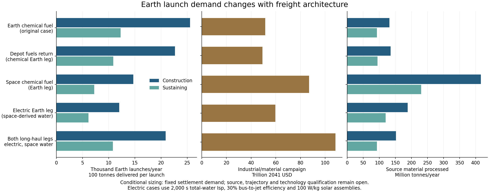

# Earth launch demand and the source of transfer propellant

The original **25,550 Earth launches per year is a result of one transport architecture**. That case launches all propellant for both directions of the low-Earth-orbit–lunar-depot route from Earth, while supplying the asteroid and lunar-surface routes from space. It establishes neither a minimum launch requirement nor the least expensive arrangement. The comparison here retains the first 250,000 residents and their material requirements, then changes propellant supply and propulsion while recalculating the factories, ships, power systems and replacement imports that support them.

The resulting construction cases range from roughly **12,000 to 25,500 launches per year** across the central architectures. Applying the earlier source-structure manufacturing proposal brings two alternatives to approximately **9,800 launches per year during construction and 4,800–5,000 afterward**. Those figures remain conditional scenarios. Further changes to manufacture, water recovery, fleet retention and trajectories could alter them substantially; no launch minimum or preferred architecture is adopted.

All dollar figures use the existing price convention: future bulk procurement assumptions expressed in 2026 purchasing power, multiplied once by **1.03¹⁵ = 1.557967** to obtain 2041 dollars, then held flat. Automation availability from 2041 is a premise. These are costs of supplying the initial settlement and retaining the industrial capacity, with the same exclusions as the [first industrial study](README.md), including a complete civil-installation and household-service dollar account, passengers, financing and planetary terraforming.

| Material launched from Earth in the original reference | Rated construction, million tonnes/year | Sustaining the completed system, million tonnes/year |
|---|---:|---:|
| Propellant for the Earth-orbit–depot route | 1.710052 | 0.822230 |
| Manufactured cargo and industrial hardware | 0.844938 | 0.406296 |
| Total reaching low Earth orbit | 2.554990 | 1.228526 |
| Propellant share | 66.93% | 66.93% |
| Launches at 100 tonnes reaching orbit per flight | 25,550 | 12,286 |

This decomposition excludes the propellant burned by the Earth launch vehicles themselves, which remains an additional environmental and energy demand. Subtracting the transfer propellant leaves about 8,450 construction launches per year **with the original hardware inventory held fixed**. Supplying that propellant from space changes the inventory, so 8,450 is a subtraction diagnostic rather than a corrected system requirement.

The comparison includes three direct responses to the propellant question and two useful extensions. The original arrangement remains available for reproduction. A second chemical arrangement buys outward fuel on Earth and refuels the empty return vehicle at the lunar depot; it retains the original 20-tonne dry vehicle and its 200-tonne outbound cargo. Full space supply instead brings the next outward trip's fuel back to Earth orbit on the returning vehicle. Electric freight uses stored water from the same source network, first for the Earth leg alone and then for both long-haul routes. Lunar landing remains chemical in every case.

| Architecture, with Earth-manufactured fleet hardware | Construction launches/year | Sustaining launches/year | Industrial establishment, trillion USD2041 | Industrial/material campaign, trillion USD2041 | Annual sustaining supply, trillion USD2041 |
|---|---:|---:|---:|---:|---:|
| Original chemical routes; Earth supplies both Earth-leg burns | 25,550 | 12,286 | 16.21 | 51.39 | 1.412 |
| Earth supplies outward burn; depot supplies chemical return | 22,658 | 10,902 | 15.75 | 49.25 | 1.355 |
| Space supplies both chemical Earth-leg burns | 14,693 | 7,251 | 31.97 | 86.93 | 2.419 |
| Electric Earth leg; chemical asteroid route | 12,030 | 6,149 | 19.81 | 59.59 | 1.729 |
| Electric Earth and asteroid routes | 20,875 | 10,806 | 36.18 | 108.37 | 3.202 |

The campaign includes establishment, initial imported settlement materials, supplier operation and renewal provision through construction, and the established allowance for settlement material replenishment during occupation. It is not depreciable capital alone. The annual column includes supplier renewal and settlement replacement imports and retains construction capacity for later growth. Retiring excess construction equipment could lower that annual requirement; a retirement and refurbishment schedule is outside this comparison.

Full chemical supply from space cuts Earth launches but raises extraction and fleet costs under these assumptions. Let a cargo vehicle carry payload P with dry mass D, and let k = exp(Δv/vₑ) − 1. With refuelling at the depot, the next ascent requires A = k(P + D). Returning that fuel to Earth orbit requires a braking burn B = k(D + A), before losses and operating margin. Both A and B must come from the source network. The new model adds the retained propellant margin and explicit handling losses to those burns, then sizes tanks and active cooling around the largest load. It credits no aerobraking or free orbital capture.

At the inherited 3.8 km/s per chemical leg and 430-second specific impulse, a 200-tonne cargo vehicle in the full-space-supply case grows to about **82.8 tonnes dry**, including its tanks and cooling equipment. During rated construction it takes about **1,253 tonnes of source-supplied propellant per cargo cycle**, including the small annualized contribution to filling the Earth-orbit inventory. Fuel carried back to Earth is useful cargo, but braking it has a substantial cost. This arrangement processes about **416 million tonnes of asteroid feed per year**, compared with 131 million in the original case. The pre-existing 9.2-million-tonne water output was already assigned to settlement replenishment, lunar landing and asteroid freight; additional Earth-leg demand requires more production.

| Source requirement | Original chemical | Depot supplies chemical return only | Space supplies both chemical Earth-leg burns | Electric Earth leg | Both long-haul legs electric |
|---|---:|---:|---:|---:|---:|
| Construction water extraction, million tonnes/year | 9.20 | 9.49 | 29.14 | 13.19 | 10.65 |
| Construction raw feed, million tonnes/year | 131.4 | 135.5 | 416.3 | 188.5 | 152.1 |
| Sustaining raw feed, million tonnes/year | 92.7 | 94.6 | 230.4 | 119.8 | 93.0 |

Space propellant therefore changes where the burden falls. It can reduce Earth launch effects while increasing disturbance at the sources, the processing fleet and the number of imported replacement parts. The scientific and heritage protections remain binding: no polar-ice mine, protected small body or new extractable-resource fraction is authorized by these throughput calculations. The eventual revenue and million-year resource accounts must use the selected physical case and distinguish raw feed, recovered products, retained tails and propellant dispersed in space.

Electric freight exchanges propellant consumption for electrical equipment and time. The central comparison assumes **2,000 seconds of specific impulse on all supplied water**, **30% electrical-bus-to-exhaust efficiency**, and **100 W/kg of solar assembly nameplate capacity**. The Earth route receives 8 km/s per leg, with 6 and 10 km/s sensitivities; its total powered time is one year within a 550-day cycle. The asteroid route receives 4 km/s per leg and one powered year within a three-year cycle. These are sizing envelopes that allow eclipse, coast and servicing time, rather than integrated trajectories. Low-thrust Earth spirals cannot simply inherit the chemical route's impulse budget.

Each vehicle's dry mass is iterated against its required fuel, array mass, drive equipment and radiators. A 200-tonne Earth cargo vehicle becomes approximately **162 tonnes dry** and needs about **7.5 MW while thrusting** in the central case. Its fleet attempts fewer trips per year than the chemical vehicles, and its arrays are replaced over ten years to allow for the demanding Earth-orbit route. Source arrays retain the original twenty-year life. Replaceable drives receive a prospective 23,000 powered-hour life, with a 10,000-hour stress test. Fleet availability remains 80%, and installed capacity retains the original 25% margin.

Those assumptions are development targets. The reviewed water-electrolysis Hall experiment reported about **2,130 seconds of anode specific impulse and 10.1% total efficiency** at its best stated hydrogen-cathode point, using bottled oxygen and hydrogen at a 1:25 mass ratio. Its anode specific impulse is measured against oxygen flow; it does not establish the total-water performance assumed here. The 23,000-hour comparison comes from a NASA xenon-system qualification target, rather than a demonstrated water-engine life. [Water-Hall experiment](https://doi.org/10.1016/j.actaastro.2024.03.043), [NASA electric-propulsion programme](https://ntrs.nasa.gov/api/citations/20240011790/downloads/IAC%20NASA%20Progress%20on%20SEP%20Thruster%20prsnt%20rev1.pdf).

At 15% efficiency, the selected electric Earth-vehicle mass and power iteration fails to close within this trip-time envelope. That rejects this combination of performance, equipment mass and flight time; a longer transfer or different propulsion system could give a different result. At **50% efficiency and 200 W/kg solar assemblies**, the comparison with both long-haul routes electric reaches about **9,702 construction launches and 4,747 sustaining launches per year**, with a **$52.18 trillion campaign and $1.49 trillion annual supply account**. This combined development case is more demanding than the central comparison and remains unqualified.

The result is also sensitive to the value of avoiding an Earth launch. Holding the central vehicle designs and other prices fixed, the electric Earth-leg campaign becomes less costly than the original case at roughly **$331/kg to low Earth orbit in 2026 purchasing power**, or **$516/kg in 2041 dollars**. Full chemical supply from space crosses at roughly $969/kg in 2026 purchasing power. At the original $200/kg assumption, refuelling only the chemical return at the depot is the least expensive of the five central cases. These crossings compare the specified campaigns; they establish neither future launch prices nor an overall optimum among possible routes.

The earlier manufacturing proposal provides another route to fewer launches. It fabricates 66.5% of the chemical asteroid cargo fleet's aggregate structural mass at its sources after the Earth-built seed, increases the dry-to-payload ratio from 0.10 to 0.12, and retains imported propulsion hardware, controls, seals and specialty parts. The comparison includes its metal refining, fabrication, process power, radiators and equipment renewal. It leaves the Earth-transfer vehicles and other equipment Earth-manufactured.

| Same source-structure manufacturing proposal applied to each route | Construction launches/year | Sustaining launches/year | Campaign, trillion USD2041 | Annual supply, trillion USD2041 |
|---|---:|---:|---:|---:|
| Earth supplies both chemical Earth-leg burns | 22,071 | 10,552 | 37.41 | 1.023 |
| Depot supplies chemical return only | 19,490 | 9,323 | 35.25 | 0.966 |
| Space supplies both chemical Earth-leg burns | 9,810 | 4,792 | 41.89 | 1.165 |
| Electric Earth leg; chemical asteroid route | 9,814 | 4,989 | 39.66 | 1.161 |

This supports a staged localization programme. Structural frames, tanks, radiators and ordinary metal parts should be evaluated first against measured feed chemistry, joining, inspection and repair performance. Pressure liners, reinforcement and seals then need their own leak, fatigue, radiation and ageing qualification. Electronics, sensors, catalysts and high-performance components need process-specific roadmaps; autonomous assembly alone does not establish a semiconductor supply chain. These stages are proposed development work, and the tables grant no further manufacturing capability beyond the existing structural comparison.

The accounting now includes extra Earth-route propellant inventories at both depots. Their initial fill comes from the space resource network and enters construction flows, annualized across the material-delivery programme like other initial stocks. A small first-dispatch allowance supplies 2% of the initial Earth-route fleet's outward fuel from Earth; subsequent dispatches use the established network. This allowance is about 12,100 tonnes for the full-space chemical case and 42,500 tonnes for the electric Earth-leg case, once across deployment. It is a stated bootstrap choice, not a demonstrated minimum. The additional fuel inventories are about 3.03 million and 0.68 million tonnes respectively. Actual commissioning must fill and verify reserves before releasing service.

Cryogenic storage receives tanks, active cooling, solar power, heat rejection, handling losses and replacement. The chemical comparisons assume 0.03 W of cooling electricity per kilogram stored and 98% retained mass at each modelled handling stage. Those are engineering allowances. NASA's 125,000-litre ground hydrogen system demonstrated active zero-boil-off storage over an extended test programme; it did not qualify these much larger orbital depots. [NASA storage experiment](https://ntrs.nasa.gov/citations/20170006481).

The remaining route design needs departure windows, Earth and lunar capture, inclination changes, radiation exposure, collision avoidance, thrust scheduling, cargo packaging, maintenance access and failure recovery. Direct source-to-Earth-orbit delivery, separate electric fuel tankers, higher Earth staging orbits, qualified aerobraking and other propellants could change the comparison. Electric schedules also require additional work in transit and a dispatch model before the earlier approximate 2074 completion date can be carried over. The calculation's production periods and cycles support a capacity comparison; they do not establish a new critical-path schedule.

The return burns in this comparison carry the specified fuel or industrial hardware; Earth-bound sale goods have not yet been added. The revenue extension must load those goods explicitly, check tank and cargo limits, and charge Earth re-entry, recovery and delivery before crediting sales.

The financial study should consequently carry transport alternatives instead of treating 25,550 launches as a system necessity. U remains a valuation unit, and the older $68/U procurement-basket calibration remains scoped to the original prices and architecture. A revised gross/net revenue comparison must reprice a matched basket and report both operating cash balance and the amount after renewal and resource allowances, with debt service separate. Expansion beyond the local Earth–Moon and near-Earth resource region, and any separate socioeconomic boundary there, remain future work.

[The calculation](transport.py), [inputs](transport_inputs.json), [source register](transport_sources.json) and [numerical product](results/transport.json) preserve the comparison without changing the original industrial or settlement products. [Verification](transport_checks.md) distinguishes numerical closure, substantive reading and visual inspection from technology or trajectory qualification.
