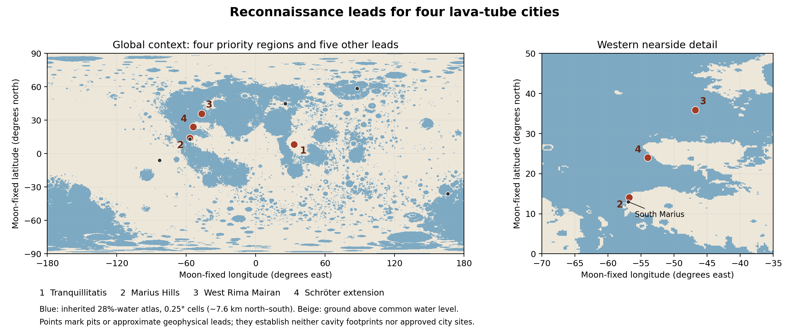

# Four lava-tube cities: initial location investigation

The literature examined identifies four plausible search regions, with Mare Tranquillitatis and Marius Hills as the two leading targets. West Rima Mairan and the Schröter extension supply two further geophysical leads, but the evidence is weaker and their access is unknown. This supports a conditional regional shortlist; it does not yet support treating all four as high-confidence locations for the planned cities. No city location is selected by this study.

This is the first stage of the [adopted four-city programme](../../plan.md#four-lava-tube-cities-and-their-supply-programme-12-november-2026), assessed on 12 November 2026. Its purpose is to determine how far existing observations can support location choices before construction, maintenance, agriculture and city industry are costed. The assessment combines a bounded reading of primary observations with the existing town population scenarios and a coarse calculation of future surface water. It includes recent entrance discoveries and announced exploration, without treating a proposed mission as a completed survey.

## The population and space to investigate

Each city is to house approximately the population of the entire first 100-town system. The [town construction study](../vacuum_crater_buildout/first_hundred.md) starts with 500 residents per town and retains larger comparisons:

| Residents in each founding town | Residents in each city | Residents across four cities | Residents in cities and towns together |
|---:|---:|---:|---:|
| 500 | 50,000 | 200,000 | 250,000 |
| 750 | 75,000 | 300,000 | 375,000 |
| 1,000 | 100,000 | 400,000 | 500,000 |

At the inherited architectural allowance of 70 m² of ordinary floor space per resident, the smaller city requires 3.5 million m². To illustrate the scale of the search, a hypothetical corridor 300 m wide and 5 km long, with four levels and 60% of their area allocated to ordinary floors, provides 3.6 million m². That arithmetic neither establishes such a cavity nor adopts that architecture. Agriculture, bulk processes, gardens, circulation and structural clearances require explicit space accounts before the illustration could become a design.

## Leading reconnaissance regions

Basaltic lava can form a solid roof over a continuing flow; drainage can then leave an underground passage. Volcanic provinces and collapse chains therefore help locate possible tubes, while images, radar and gravity measure different aspects of the evidence. An overhang demonstrates sheltered space near an opening. A radar return or gravity deficit can support a subsurface-void interpretation without determining accessible floor area, connections or rock condition. The [LunarLeaper mission study](https://arxiv.org/abs/2609.11453) describes the exploration needed to resolve those questions.

The map locates the four priority regions and five additional leads against the inherited common-level waters. Its western nearside detail shows how several leads concentrate around the same prospective sea. Generate it with `python -m research.studies.lava_tube_cities.plot`.

The table gives present Moon-fixed coordinates with east longitude. A coordinate names an entrance or a published anomaly reference point, rather than a city footprint. Heights come from the project's 28%-water atlas, sampled on its 0.25° grid: approximately 7.6 km per cell north–south. Negative heights indicate ground below the model's common water level; they are conditional future water depths, not present water observations.

| Priority region | Reference location | Evidence and remaining location question | Coarse ground height above future common water level |
|---|---|---|---:|
| Mare Tranquillitatis | Pit: 8.3355° N, 33.2220° E | A mapped pit and radar-supported conduit provide a concrete entrance target. The conduit extends tens of metres from the pit; its full extent and city capacity remain unknown. | +788 m |
| Marius Hills | Pit: 14.0917° N, 303.2299° E | Pit overhangs, regional radar returns and gravity evidence make this a strong province to investigate. A traversable connection from the pit into extensive usable space is unresolved. | +75 m |
| West of Rima Mairan | Radar point P0: 35.892° N, 313.235° E | Associated radar echoes and a regional mass deficit support further geophysical work. No surveyed entrance or accessible interior establishes city capacity. | −616 m |
| Schröter extension | Approximate anomaly: 24° N, 306° E | A gravity inversion permits a large cavity. Its interpretation, access and connected interior require investigation. | −270 m |

For Tranquillitatis, the [LROC pit catalogue](https://lroc.im-ldi.com/atlases/pits/3) records an inner opening about 88–100 m across and visible overhangs. NASA's [account of the 2024 radar result](https://science.nasa.gov/solar-system/moon/new-evidence-adds-to-findings-hinting-at-network-of-caves-on-moon/) describes a conduit extending more than 200 feet, roughly 60 m, from the pit base, with its full extent unknown. This provides a particularly useful target for an interior survey, while leaving a substantial gap between observed extent and the illustrative kilometres of city floor.

At Marius, [Kaku et al. (2017)](https://doi.org/10.1002/2017GL074998) interpret radar and gravity evidence as an intact tube. Their regional search contains many candidate radar returns; it does not map a continuously traversable, city-ready interior. The [pit catalogue](https://lroc.im-ldi.com/atlases/pits/1) describes a roughly 49–55 m inner opening and rubble that complicates access. NASA's September 2026 selection of [GIMLI](https://www.nasa.gov/news-release/nasa-adds-new-science-investigations-for-moon-base/) explicitly includes testing whether the pit opens into a larger tube. That investigation remains prospective in this assessment. The older project estimate of a 30 km Marius tube must consequently remain a hypothetical capacity input.

West Mairan's [published radar study](https://www.hou.usra.edu/meetings/lpsc2018/pdf/1830.pdf) examines echoes near P0 alongside a gravity deficit. Its short conference report leaves alternative subsurface interpretations and access unresolved. For Schröter, [Chappaz et al. (2017)](https://doi.org/10.1002/2016GL071588) fit a gravity anomaly with a cavity model approximately 3.75 km wide, 600 m high and 60 km long. Those are inversion parameters, not measured cave dimensions; the very large implied volume cannot be entered as surveyed capacity.

The two leading targets merit reconnaissance priority because their evidence includes identifiable entrances. The other two extend the search to plausible large subsurface structures. This ordering is a qualitative assessment of the examined evidence, without calibrated confidence percentages. Four cities need not occupy four provinces: several suitable cavities within Marius could ultimately support several cities, but repeated measurements of one possible structure do not establish separate locations.

## Additional entrances and comparisons

The remaining leads broaden the reconnaissance options without closing the four-location gap.

| Lead | Evidence relevant to follow-up | Coarse ground height above future common water level |
|---|---|---:|
| South Marius Hills | A possible entrance near a proposed collapse chain, reported in 2025; the depression is only about 14–15 m deep and its interior extent is unknown. | +91 m |
| Mare Ingenii | Visible overhangs extend about 10–20 m; extensive connected space has not been measured. | −1,926 m |
| Lacus Mortis | A ramp reaches the floor, but an apparently visible back wall limits what the shallow overhang demonstrates. | −338 m |
| Bel'kovich A | A 2025 possible entrance; illumination complicates confirmation of the overhang. | −2,720 m |
| Schlüter | A small highland pit near a mare patch, with an overhang but no established extensive volcanic cavity. | +183 m |

The new South Marius and Bel'kovich candidates come from [Le Corre et al. (2025)](https://doi.org/10.1016/j.icarus.2025.116675). The images expand the entrance catalogue; an image detector's confidence concerns recognition of a feature, rather than the probability of a viable city. The other comparisons use the LROC entries for [Ingenii](https://lroc.im-ldi.com/atlases/pits/6), [Mortis](https://lroc.im-ldi.com/atlases/pits/8) and [Schlüter](https://lroc.im-ldi.com/atlases/pits/18). South Marius belongs to the same broader volcanic province as the existing Marius lead.

## Water, conservation and the town network

The new water comparison corrects a material location mismatch in the [earlier land-city study](../land_cities/README.md). Its Schröter entry sampled the named valley centre at 26.16° N, 308.42° E and obtained ground about 95 m above common sea level. The gravity paper instead places the Schröter extension anomaly near 24° N, 306° E, where the present coarse sample lies about 270 m below that level. The original product is retained as a historical calculation; its valley-centre dry classification cannot qualify the anomaly's location. A full corridor survey could span several elevations and has not been performed.

The atlas places Tranquillitatis comfortably above common sea level and Marius much nearer it. South Marius's surrounding nine cells span roughly −46 to +254 m, demonstrating the need for finer terrain before deciding access or flood protection. Even positive ground height leaves cave-floor elevation and groundwater unresolved. Regional climate and illumination also need evaluation in the planned Open Moon orientation; the present Moon-fixed latitudes identify the literature locations rather than future climate bands. The new calculation omits rain-fed lakes, groundwater, tides, later deformation and water loading; its neighbourhood range describes nearby sampled terrain, not a statistical error bar.

Future submergence is a design burden rather than an automatic exclusion. The project already permits lasting underground and undersea communities. A Mairan or Schröter location would need access, drainage or watertight construction compatible with the growing water inventory, alongside the changing atmosphere. Whether that is preferable to a dry region requires the site geometry and a later engineering comparison.

Conservation screening is also incomplete. Entrances and pristine interiors may preserve valuable geological records; selecting a construction zone would require explicit scientific and heritage review, protected areas and controlled access. This study supplies no conservation clearance. The same sustainability and resource protections used for the towns remain applicable.

The first 100 towns have a construction scenario but no approved geographic allocation. The broader provisional vacuum-crater set therefore cannot supply a first-100 route map. City–town distances, pressure-safe surface travel, freight, emergency access, shared utilities and the allocation of towns to cities remain to be determined together once candidate city areas are usable. No four equal town catchments are imposed.

## What would permit the next stage

A useful next reconnaissance phase would seek connected geometry, roof and rock condition, accessible entrances and the cave floor's relation to future water. Surface radar, gravity and seismic measurements can narrow the cavity interpretation; robotic interior mapping would then establish which spaces actually connect. The location assessment must also identify surface land for power and heat rejection, transport approaches and areas protected for science. Detailed construction qualification follows an area choice; it is not a prerequisite for merely investigating a region.

Local food production remains part of the adopted city programme. The town account already includes food-process power, so any transfer of production into the cities must remove the corresponding town allocation before counting a shared facility. The later comparison should test hydroponics and other intensive systems against complete diets, crop yields, lighting and lunar-night power, water and nutrient recovery, waste heat, reserve capacity and food transport. Suitable bulk processes need their own space and service accounts. Protected underground space alone does not establish that agriculture is cheaper there, and this location investigation does not make that claim.

The present recommendation is to keep Tranquillitatis and Marius as leading reconnaissance targets, retain Mairan and Schröter as geophysical follow-ups, and report the unfilled four-location requirement before city design and cost work proceeds. A conditional four-city scenario remains possible if explicitly authorized, with assumed cavities labelled throughout. The following mining, manufacturing and Earth/near-Earth procurement study remains planned; the initial economic conversion for U is still unset.

## Reproduction and source limits

[Inputs](siting_inputs.json) bind the inherited town scenarios, architectural allowance, atlas and historical land-city product by SHA-256 and schema. [siting.py](siting.py) calculates the population comparisons, hypothetical floor area and coarse point samples; [results/siting.json](results/siting.json) preserves those outputs separately from the qualitative assessment. Reproduce with `python -m research.studies.lava_tube_cities.siting`; run its numerical and provenance controls with `python -m pytest research/studies/lava_tube_cities/test_siting.py`. The default run writes into ignored `research/runs/`.

The [source register](sources.json) identifies reading scope, access dates and archived copies. The full Carrer et al. (2024) paper could not be retrieved during this investigation; its limited conduit claim is supported here through NASA's mission account, and detailed paper geometry is not admitted. The LunarLeaper source was read only for its abstract and introductory exploration context. This is a bounded location review, without new orbital-data analysis or an exhaustive literature search. [checks.md](checks.md) records the actual verification and unresolved evidence.
