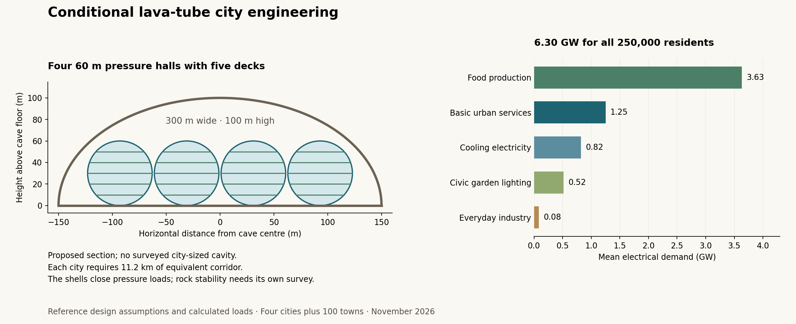

# Four lava-tube cities and the founding towns: construction and sustaining costs

Four cities of 50,000 residents, together with 100 towns of 500, have a **reference construction allowance of 578 billion U and annual sustaining funding of 22.2 billion U for 250,000 people**. The estimate includes shared food production, aquaculture, everyday light industry, utilities, regional transport and basic civic services. It describes a coordinated build in assumed usable, dry caves, supplied by the same advanced space economy as the [first-town estimate](../vacuum_crater_buildout/first_hundred.md). Geological suitability, qualified construction and future procurement prices remain conditions of the calculation.

**U is the project's common real-price unit; its conversion to present Earth money remains unset.** The [calculation](buildout.py), [inputs](buildout_inputs.json) and [numerical product](results/buildout.json) preserve the inherited price basis. The three cases vary supplier prices, upkeep rates and component lives around the same physical reference. They form a planning range, without probabilities attached.

| Combined system of 250,000 residents | Lower-price, longer-life case | Reference | Higher-price, higher-wear case |
|---|---:|---:|---:|
| Initial construction and establishment, billion U | 193 | 578 | 2,016 |
| Annual operations, routine upkeep and operating margin, billion U/year | 2.70 | 12.26 | 84.34 |
| Annual provision for component renewal, billion U/year | 2.95 | 9.93 | 45.03 |
| Total annual sustaining funding, billion U/year | **5.66** | **22.19** | **129.37** |
| Sustaining funding per resident, U/year | 22,600 | 88,800 | 517,000 |

The reference adds **449 billion U** to the original 129 billion U town-only construction bill after reconciling common facilities. Dividing that addition among four cities gives about **112 billion U per city with its share of the regional system**. A city built alone would require a separate estimate because these costs include services for the towns. Annual funding likewise describes a settlement and service system; it is not a household spending requirement. The earlier town maintenance account covered physical upkeep and selected operating services, so its scope was narrower.

## Caverns, pressure and the eventual open city

The [location investigation](README.md) identifies search regions, including two leading entrance targets, but establishes no city-sized accessible cavity. The engineering case therefore specifies the space that reconnaissance would need to find. Each city requires approximately **7.62 million m² of usable floors**, including its quarter of the food and industrial system. Four parallel lanes of 60 m diameter pressure halls, each with five decks, fit within an idealized cave 300 m wide and 100 m high. At 75% usable deck area, 80 closed modules per city provide sufficient floors. A module has 500 m of straight length and two hemispherical ends; twenty modules along each lane require **11.2 km of equivalent cave length per city**. A real set of connected cavities could arrange that space differently, with new access or connecting excavations assessed separately.

The left panel shows the assumed cross-section, including 2 m between adjacent halls. Deck lines locate potential floors; their structural design remains open. The right panel separates the reference system's mean electrical demand. Both panels depict calculated requirements and proposed geometry, rather than a surveyed cave or a qualified building.

The natural roof supplies shelter from direct radiation and impacts, subject to verifying cover, fractures and entrance exposure. The costed proposal contains pressure within independent closed shells inside the cave. This proposal allows streets, housing, parks and workspaces to connect through ordinary pressurized passages, with closures available for fire or pressure isolation. It preserves the single contiguous dome architecture already adopted for the small towns; the city halls are a separate comparison for much larger settlements.

At an initial internal pressure of one atmosphere, each 60 m hall end carries **286 million newtons**. Cylinder hoop and axial loads and spherical-end loads determine the reinforcement quantities before a factor of two for joints and structural detail. The inherited 600 MPa effective allowable is a development assumption, with 400 MPa tested separately. Liners, independent supports, rock stabilization and four access/escape sets per city receive additional allowances. The calculated pressure structure remains incomplete: doors, penetrations, creep, fire, low-gravity evacuation, fracture behavior and repair procedures require qualification.

A 100 m basalt cover has weight equivalent to about 4.8 atmospheres under lunar gravity, but that ratio alone cannot qualify cave pressurization. The examined publisher preview of [Martin and Benaroya (2023)](https://doi.org/10.1016/j.actaastro.2022.12.013) reports pressure-related failure in its rock models; its full paper remains unretrieved. The present shell calculation uses no rock allowable from that preview. A later comparison could assess engineered use of sound rock if site investigations establish suitable conditions.

Permanent decks and supports would be designed to carry their loads independently of inflation. As external atmospheric pressure rises, pressure controls would follow it to prevent reverse loading; the initial one-atmosphere inventory is the vacuum operating case. Once ambient air is sustainably breathable, pressure skins and unnecessary airlocks can be removed, leaving the connected city beneath its natural roof. Ventilation, cooling and drainage would change through this transition. The reference assumes dry, flood-safe floors and access throughout; the possible Mairan and Schröter settings under future water would need separately costed waterproofing and access. The initial 5% transition reserve funds planned adaptation and removal within the assumed setting, rather than establishing the cost of an underwater city.

## Food for all 250,000 residents

The vacuum production case supplies 2,500 food kilocalories per resident per day through cultivated plants, recirculating fish and processed microbial protein. Most calories come from plants. Fish supplies 28 g of edible fillet per resident per day, while microbial protein supplies another 18.7 g of protein. At an assumed 12% protein in edible dry plant matter, the basket provides roughly 102 g of protein per person per day. These aggregate balances size calorie and protein production; dietary variety, fats, micronutrients, feed formulations and lunar crop and animal performance still need a qualified menu and trials. The mature Open Moon's adopted food blend remains a distinct scenario.

NASA's [crop review](https://www.frontiersin.org/journals/astronomy-and-space-sciences/articles/10.3389/fspas.2021.734343/full) discusses ground-based estimates near 40–50 m² of crops per person for food calories. The inherited [food study](../food_systems/README.md) supplies the detailed crop-lighting, fish and microbial precedents. The model assumes a yield of 50 kcal/m²/day at 40 mol of photosynthetically active photons/m²/day. Growing area is then increased by a 1.3 crop-loss multiplier, a 1.15 variety allowance for human food and the crops needed for fish feed. Projected lamp efficacy is 3.5 micromoles per joule; the 2.5 micromoles per joule comparison retains a less efficient precedent.

| Shared production requirement | Four-city system | Per-city allocation |
|---|---:|---:|
| People supplied, including the towns | 250,000 | 62,500 |
| Active crop beds | 20.06 km² | 5.02 km² |
| Installed crop beds, including spare capacity | 26.75 km² | 6.69 km² |
| Farm floor with four crop layers and service space | 8.69 km² | 2.17 km² |
| Annual edible fish | 2,557 tonnes | 639 tonnes |
| Annual live-fish production | 6,392 tonnes | 1,598 tonnes |
| Annual fish feed, grown in the crop account | 9,588 tonnes | 2,397 tonnes |
| Annual microbial protein | 1,705 tonnes | 426 tonnes |
| Installed fish-tank water volume | 85,225 m³ | 21,306 m³ |
| Stored food, 180 days plus 10% allowance | 35,357 tonnes | 8,839 tonnes |

Fish feed is charged at 1.5 kg per kilogram of live fish and a 40% fillet yield. Recirculating aquaculture includes pumping, water treatment and processing, with its 3.09 kWh/kg live-fish operating precedent inherited from commercial-system evidence. Microbial protein uses an assumed 60 kWh/kg of protein for the production process. Neither stream provides free calories, nutrients or waste disposal. Their controlled environments need appropriate temperature, oxygen, chemistry, pathogen management and independent water-treatment loops.

Each city receives a quarter of the production plant. Installed crop and fish capacity is one third above nominal demand, so three cities retain nominal aggregate food capacity if the fourth stops producing. That arithmetic does not establish immediate recovery: crops must mature, fish must grow and unaffected systems must remain healthy. Food reserves distributed among city districts and town stores provide time for those responses; evacuation accommodation requires its own design. Rotation uses the stored food in ordinary meals, so its full initial inventory is not charged again as an annual loss.

The crop loops condense an assumed 99.5% of transpired water; fish effluent treatment recovers 95% of the already identified purge stream. These are separate assumptions. NASA's [98% station-water recovery result](https://www.nasa.gov/missions/station/iss-research/nasa-achieves-water-recovery-milestone-on-international-space-station/) applies to collected station water and does not demonstrate closure of a city, farm or fishery. Nutrient recovery is assumed at 95%, with carbon and trace makeup added. Initial carbon and nutrient stocks are delivered before the farms fill the food reserve. The element account is an allowance for nutrient supply, with crop-specific salts, contaminants and losses still to resolve.

## Everyday industry, power and regional connections

The light-industry allowance provides **2.5 million m² of workshops and production floors** and capacity for **125,000 tonnes of ordinary goods per year**, equivalent to 500 kg per resident. Its remit includes clothing and textiles, furniture, household goods, packaging, ordinary tools, assembly, maintenance workshops, cleaning products and material recovery. Precision electronics, specialized medicines and other difficult consumables retain a separate import allowance. Mining, primary refining and large machinery manufacture belong to the following supply study. Replacement of the durable assets costed here is purchased through their renewal account, so it is excluded from the 500 kg everyday-goods basket.

At 90% material recovery, ordinary goods require 12,500 tonnes of new material each year: 10,000 tonnes of local mineral feed and 2,500 tonnes of imported carbon-bearing feed. The process allowance is 5 kWh/kg of output, with recycling energy added. Reference staffing provides 1,000 food-production operators and 2,000 light-industry operators across the system; the assumed automation and work rates have not been demonstrated. Technical upkeep is charged separately, while basic civic services receive 5,000 U per resident-year for operating healthcare, education, public administration and comparable services beyond their installed buildings.

Total mean electricity is **6.30 GW**, of which food uses **3.63 GW** before the separate central cooling allowance. Crop photoperiods would be staggered across zones. Installed occupied supply is **9.59 GW**, allowing spare food production and a further 20% power margin; another 2 GW supports construction, bringing initial capacity to **11.59 GW**. The reference maintains the adopted beamed-power programme and requires commissioned supply through the lunar night. It purchases firm capacity rather than asserting that the necessary source, relay and receiving systems already exist.

The **105 GWh** emergency reserve supports the specified 3.5 kW per resident critical load for 72 hours after usable-capacity, efficiency and reserve factors. Full crop lighting is outside that emergency duty. Keeping the entire mean load through half a lunar month would require approximately **3.72 TWh** under the same storage convention, costing 372 billion U for the store alone at the reference price, before extra generation and charging losses. Night continuity therefore materially affects this budget.

At 80% receiver efficiency and with a cooling-electricity allowance of 15% of end-use demand, average rejected heat is **7.88 GW**. The initial system carries **47.9 km² of radiator emitting surface**, calculated at 330 K with twice the ideal area; 39.6 km² remains allocated to occupation when construction capacity is retired or reassigned. Emitting area is distinct from surface land occupied. Shadowing, sunlight, view factors, heat-pump performance, fluid circuits and atmospheric transition still need engineering. The cave does not provide an unlimited heat sink.

The transport allowance retains the towns' 500 km of roads and adds **3,000 km of regional corridors**. Pressurized passenger and freight vehicles, docking interfaces, maintenance depots, communications, rescue and shelter provisions would support travel through vacuum; ordinary atmospheric road vehicles cannot supply those functions. An initial service grouping of one city and 25 towns is a planning allocation, with all cities interconnected where surveyed routes permit. Their locations remain unselected, so neither that grouping nor the distance allowance constitutes a route plan. Town approaches, regional links and city access must stay usable as air and water accumulate.

## Construction and material accounts

The coordinated estimate replaces the towns' generic food and industry allocations with the explicit common plants. The reference allocates 10% of ordinary capital to food and 15% to light industry, crediting those amounts and the associated extra freight before adding the new production facilities. The original ordinary-capital estimate was not itemized, so a no-production-credit comparison is retained. The entire earlier town power, storage and radiator budget is also replaced by the integrated utility account, with retained town loads included once. The original town products and their single-dome designs remain intact.

| Reference initial funding | Billion U |
|---|---:|
| Retained town construction after common-service credits | 73.82 |
| City ordinary buildings, services and extra equipment delivery | 82.50 |
| City pressure shells, supports, rock treatment, grading and access | 105.22 |
| Agriculture, aquaculture, fermentation and food processing | 18.50 |
| Everyday light industry | 10.00 |
| Additional regional routes, vehicles and docking | 11.50 |
| Integrated power, reserves, exterior cooling and city garden lights | 78.62 |
| Initial air, water, biosphere, food and nutrient stocks | 6.12 |
| Added survey, qualification, regional startup, construction energy and restoration | 26.73 |
| **Direct cost** | **413.01** |
| Contingency, 35% of direct cost | 144.55 |
| Transition and removal reserve, 5% of direct cost | 20.65 |
| **Total initial funding** | **578.22** |

The reference uses inherited charges of 60 U/kg for installed pressure systems, 3 U/kg for additional local structure, 5 U/W for firm electricity capacity and 1 U/kg for delivered air and water. New food and industry prices are explicit assumptions: 350 U/m² of crop beds plus 700 U/m² of farm floors, and 4,000 U/m² of light-industry floors. Installed prices recover suppliers' normal machinery, manufacture, delivery and capital costs. Adding the full cost of those same upstream factories to this bill would count their supply twice; the following industrial study must replace the purchased-service assumptions with a reconciled supply account.

Commissioned stock and major construction feed require about **79.5 million tonnes of local material installed in structures, shielding and roads**, **146.5 million tonnes of raw feed**, **4.24 million tonnes of specialist equipment, biological and chemical imports**, and **4.96 million tonnes of initial air and water**. Cave grading moves another 20.2 million tonnes. Local solids constitute about 90% of the tracked delivered construction inventory by mass. Roughly 59.8 million tonnes of added processing tails remain available for controlled retention and later use; their quantity grants no disposal or extraction approval. The estimated construction and initial food-stock electricity totals **203 TWh**.

Resource acquisition retains the project's requirements for scientific recording, heritage evaluation, protected areas, future resource reservations and controlled disturbance. Ordinary rock and selected metals may be processed locally where those reviews permit. Air, water, carbon and scarce nutrients arrive through permitted Solar System and Earth supply; this case assumes no polar-ice extraction. The gross raw-feed quantity corresponds to approximately 4.88 km² of quarry excavation at an assumed 10 m working depth, before geological selectivity, access, retained tails and restoration space. The new transport corridors alone reserve 60 km² at a 20 m width, and utility sites require their own land assessment.

A simple 200-year resource diagnostic reserves 127 million tonnes of raw feed for the added stock when replacement averages fifty years and end-to-end material return is 95%. This cannot replace deposit- and element-specific reservations, particularly for nutrients and useful coproducts. The first physical account tracks major stock and process flows; construction-worker provisions and supplier consumables remain in the installed service charges rather than a complete shipment manifest.

## Sustaining the towns and cities through a long vacuum period

Reference annual funding comprises **6.73 billion U for routine technical upkeep**, **3.49 billion U for operating supplies and services**, a **2.04 billion U operating margin**, and **9.93 billion U for component renewal**. Routine upkeep uses the inherited 2% of maintained installed value. Reference replacement lives include eight years for farm lamps, twenty for production equipment and batteries, twenty-five for pressure liners, fifty for reinforcement and a hundred for independent supports. These are planning service lives; inspection, replacement access and degradation tests must establish actual intervals.

Operating supplies include food and industrial feedstock, water and air losses, purchased variable electricity, specialist consumables, production staff and the basic civic-service allowance. Durable replacements include their delivered installation costs; local structural renewal also purchases conversion electricity. Construction-only power and radiator capacity is excluded from steady occupied maintenance after reassignment or retirement. Financing, migration fares, discretionary luxury consumption, optional heritage-animal husbandry, the global atmosphere and seas, and the wider planetary protection programme remain outside this settlement account.

The reference needs **about 1.01 million tonnes of annual imports**, including 847,000 tonnes of replacement water and 139,000 tonnes of replacement hardware. The water total retains a conservative inherited 5 kg per resident-day landscape/other makeup allowance, in addition to household recovery losses and the separately calculated farms, fish and industry. Recovering more of that flow would reduce deliveries, while weaker crop recovery would increase them. Continuous supply and stocks therefore remain part of sustainability even with extensive local production and recycling.

Undiscounted spending in constant reference U is approximately **1.46 trillion U over fifty vacuum years**, **4.71 trillion U over two hundred**, and **11.4 trillion U over five hundred**, including initial construction, recurring operations and replacement events strictly before each endpoint. These totals begin with full occupation and charge actual replacements instead of adding the annual renewal fund again. They assume repeated replacement succeeds and prices remain on the same real basis; they set no terraforming date or financial valuation.

## Construction sequence, sensitivities and next work

The common-service credits require a coordinated programme: survey and preserve the sites, qualify accessible pressure sections, commission power and initial farms, then increase town and city occupation as food and utility capacity grows. The surface towns retain their permanent gardens and domestic life while the city plants supply the regional food and goods accounts. If the complete original town infrastructure has already been purchased, crediting it would require recovery of its value. Retaining the whole original bill with no recovery raises the initial-spending diagnostic to **604 billion U**, before temporary operation between construction stages.

An assumed regional system processing 4.5 million tonnes of bulk material and 360,000 tonnes of metal a year, while fitting out 1.8 million m² of floors annually, takes roughly **31 years from regional mobilization** after adding an eight-year qualification/access lead, a ramp allowance and final commissioning. Metal output and floor completion set the longest streams. Recurring living costs during phased occupation are additional to the initial construction bill; the annual figures describe the fully occupied system. A staged cash-flow and commissioning schedule remains to be developed. This is a throughput calculation, conditional on simultaneous supplier readiness and successful qualification; it does not establish a detailed construction schedule or include development of the supplying space economy from today's starting point.

| Change to the reference, with other assumptions held fixed | Initial funding, billion U | Annual sustaining funding, billion U/year | Consequence |
|---|---:|---:|---|
| Half the crop yield per bed area | 692 | 26.88 | Mean electricity rises to 10.42 GW; equivalent cave length to 14 km per city. |
| Lamp efficacy of 2.5 micromoles/J | 600 | 23.05 | Mean electricity rises to 7.95 GW. |
| City reinforcement allowable of 400 MPa | 615 | 23.34 | City reinforcement mass rises by half; the inherited town design is held fixed. |
| Additional routes increased from 3,000 to 6,000 km | 592 | 22.66 | More roads, restoration and renewal; actual geography remains unresolved. |
| Radiators at 300 K | 585 | 22.41 | Required emitting area grows, with the heat-pump electricity allowance held fixed. |
| Crop-water recovery reduced to 98% | 578 | 22.72 | Annual imports rise to 1.45 million tonnes. |
| No credit for generic food/industry capital | 627 | 23.84 | Preserves the original ordinary-capital allowance while adding the explicit common plants. |

The present contribution is a common population, space, food, utility, material and U account for the initial settlement system. It identifies cavern capacity, pressure-shell qualification, crop productivity, continuous electricity and supply continuity as conditions that the next engineering work must resolve. It also gives the industrial study concrete quantities to supply and renew, without choosing four city sites prematurely.

A **Moon-wide lava-tube distribution study with a 2.5% eventual buildout target is recorded as future work**. Its inventory must distinguish entrances, connected tube systems and usable segments before applying that percentage; neither the crater count nor a list of pit openings supplies the denominator. Mining, manufacturing, near-Earth procurement and Earth transfers form the next planned supply study, followed by the first conversion of U to current Earth economics.

The [source register](buildout_sources.json) identifies new reading and inherited evidence. The [verification record](buildout_checks.md) distinguishes numerical checks, source coverage, editorial reading and the remaining engineering work.
